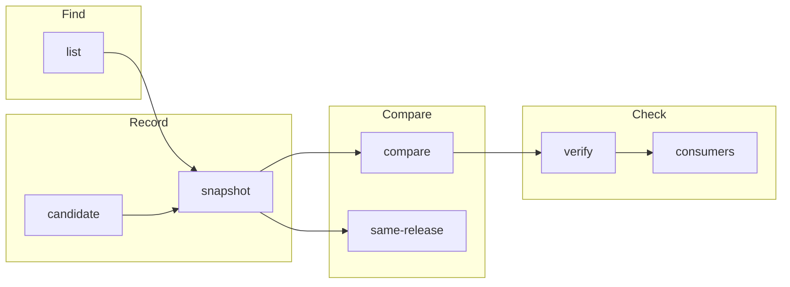

# Commands

`strata --help` lists the commands by task, in the order that a team uses them:

```text
{{#include ../output/help.txt}}
```

## The commands in a release cycle



| Task | Command | Page |
| --- | --- | --- |
| Find a ref, a project, or the profiles with a pack | `strata list` | [list](./list.md) |
| Record a profile version or a cluster | `strata snapshot` | [snapshot](./snapshot.md) |
| Write a candidate file for a review | `strata candidate` | [candidate](./candidate.md) |
| See what changed between two refs | `strata compare` | [compare](./compare.md) |
| Make sure that records in several projects are one release | `strata same-release` | [same-release](./same-release.md) |
| Make sure that Palette still has what you recorded | `strata verify` | [verify](./verify.md) |
| Find the clusters that use a version | `strata consumers` | [consumers](./consumers.md) |
| Get the JSON Schema of a document | `strata schema` | [schema](./schema.md) |

## Refs

A ref names what a command reads. [Refs](../reference/refs.md) gives the
details.

| Ref | Example |
| --- | --- |
| A profile uid | `64e0000000000000000000c3` |
| A name and a version | `aws-stack@1.1.1` |
| The highest version of a name | `aws-stack@latest` |
| All profiles that a cluster runs | `cluster:payments` |
| One profile that a cluster runs | `cluster:payments/aws-stack` |
| A snapshot file | `releases/1.1.1/dev.json` |

## Exit status

| Exit | `compare` | `same-release` | `verify` | `consumers` |
| --- | --- | --- | --- | --- |
| `0` | identical | each pair passes | each record unchanged | no cluster uses it |
| `1` | different | a pair fails | a record drifted | a cluster uses it |
| `2` | error | error | strata cannot check a record | error |

`list`, `snapshot`, `candidate`, and `schema` exit `0`, or `2` on an error.
Treat `2` as a failed job. It never means "no change".

## Output formats

`compare`, `same-release`, `verify`, `consumers`, and `list` take the same
options:

| Option | Output |
| --- | --- |
| `--format terminal` | The default. Text, with color on a terminal. |
| `--format markdown` | Tables for a pull request comment or an issue. |
| `--format json`, `--json` | A JSON document for a script. |
| `--compact` | The JSON on one line. |
| `--color auto\|always\|never`, `--no-color` | Color of the terminal text. |
| `-q`, `--quiet` | No progress messages on standard error. |

[Report formats](../reference/formats.md) and
[JSON documents](../reference/documents.md) describe each output.
