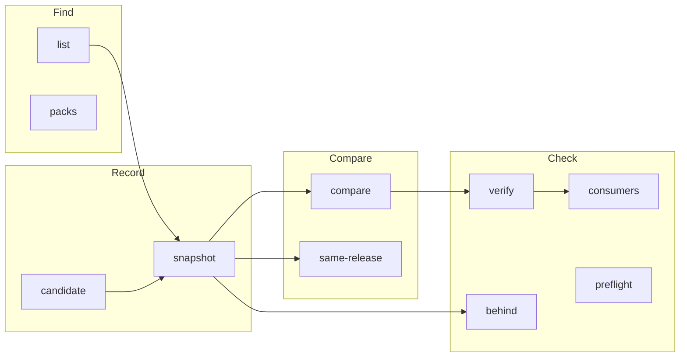

# Commands

`strata --help` lists every command, and `strata <command> --help` gives the
options of one:

```text
{{#include ../output/help.txt}}
```

## The commands in a release cycle

[The everyday loop](../loop.md) says who runs each command, and when.



| Task | Command | Page |
| --- | --- | --- |
| Find a ref, a project, the profiles with a pack, the clusters with a label, or the saved tag filters | `strata list` | [list](./list.md) |
| Find the versions a registry offers for a pack | `strata packs` | [packs](./packs.md) |
| Record a profile version, a cluster, an edge host, a cluster group, an app profile, a pack version, or each cluster of a set | `strata snapshot` | [snapshot](./snapshot.md) |
| Write a candidate file for a review | `strata candidate` | [candidate](./candidate.md) |
| See what changed between two refs | `strata compare` | [compare](./compare.md) |
| Make sure that records in several projects are one release | `strata same-release` | [same-release](./same-release.md) |
| Make sure that Palette still has what you recorded | `strata verify` | [verify](./verify.md) |
| Find the clusters that use a version | `strata consumers` | [consumers](./consumers.md) |
| Find the pack versions that records pin behind a newer one | `strata behind` | [behind](./behind.md) |
| Check that Palette can build a cluster, before the build | `strata preflight` | [preflight](./preflight.md) |
| Get the JSON Schema of a document | `strata schema` | [schema](./schema.md) |

## Refs

A ref names what a command reads. [Refs](../reference/refs.md) gives the
details.

| Ref | Example |
| --- | --- |
| A profile uid | `64e0000000000000000000c3` |
| A name and a version | `aws-stack@1.1.1` |
| The highest version of a name | `aws-stack@latest` |
| All profiles that a cluster runs | `cluster:payments` |
| One profile that a cluster runs | `cluster:payments/aws-stack` |
| A pack version in a registry | `pack:csi-aws-ebs@1.65.0` |
| The update that waits for a cluster | `cluster:payments@pending` |
| The profiles bound to an edge host | `edgehost:store-1` |
| The profiles that a cluster group pins | `clustergroup:dev-group` |
| An app profile | `appprofile:shop@1.0.0` |
| The clusters with a label, for `snapshot --dir` | `tag:env=prod` |
| The clusters that a saved tag filter selects, for `snapshot --dir` | `filter:production` |
| A snapshot file | `releases/1.1.1/dev.json` |

## Exit status

| Exit | `compare` | `same-release` | `verify` | `consumers` | `behind` |
| --- | --- | --- | --- | --- | --- |
| `0` | identical | each pair passes | each record unchanged | nothing the key can read uses it | no pin is behind |
| `1` | different | a pair fails | a record drifted, or is unverified | a cluster or an edge host uses it | a pin is behind |
| `2` | error | error | strata cannot check a record | nothing found, and a reading failed | strata cannot check a pin |

`list`, `packs`, `snapshot`, `candidate`, and `schema` exit `0`, or `2` on an
error.
Treat `2` as a failed job. It never means "no change".

## Output formats

`compare`, `same-release`, `verify`, `consumers`, `behind`, `list`, and `packs`
take the same options:

| Option | Output |
| --- | --- |
| `--format terminal` | The default. Text, with color on a terminal. |
| `--format markdown` | Tables for a pull request comment or an issue. |
| `--format json`, `--json` | A JSON document for a script. |
| `--compact` | The JSON on one line. |
| `--color auto\|always\|never`, `--no-color` | Color of the terminal text. |
| `-q`, `--quiet` | No progress messages on standard error. |

[Report formats](../reference/formats.md) and
[JSON documents](../reference/documents.md) describe each output.
