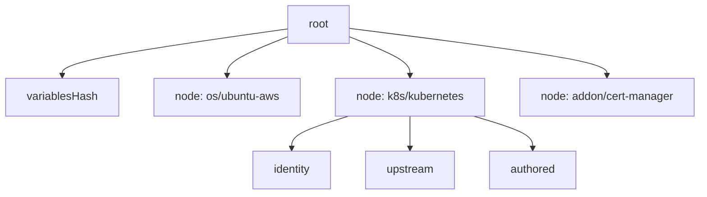

# The hashes and the root

This page tells how strata calculates the root. You do not need it to use
strata.

## Three hashes for each pack

A profile is a list of packs in layer order. Strata calculates three hashes for
each pack, so a report can say which part of a pack changed:

| Hash | Calculated from | Palette concept |
| --- | --- | --- |
| `identity` | the pack name, layer, type, tag, version, `packUid`, and `registryUid` | which pack build the layer references |
| `upstream` | the `digest` on the pack reference of the profile | the content of the pack in the registry |
| `authored` | the canonical values, the content of each attached manifest, and the params | the configuration of the pack on the profile |

The [change flags](../reference/impact.md) `IDENTITY`, `UPSTREAM`, and
`AUTHORED` show which of the three hashes differ.

## The node hash and the root

```text
node = sha256(identity + upstream + authored)
root = sha256(variablesHash, [key, node] for each pack, in profile order)
```

`key` is `<layer>/<name>`. `variablesHash` covers the profile variables: the
configuration interface of each deployment. The variables are not part of a
pack, so they have their own hash.

The hash keeps a fixed set of fields of each variable: the name, the display
name, the description, the format, the default value, the regex, the flags
`required`, `immutable`, `hidden` and `isSensitive`, the input type, and the
label, value and description of each option. It keeps no id. The profile
variables endpoint serves those fields and no uid, so no field that Palette
mints reaches the hash.



The root and the node hashes form a Merkle tree. A change in any pack changes
its node hash, and so the root. Two profile versions with the same root are the
same release.

The root does not cover the uid, the name, the version, or the project of the
profile. So the dev and prod copies of a version, and a candidate and its
published version, can have one root.

## When Palette does not serve the variables

An older Palette does not serve the variables endpoint. Strata then reads the
version as one with no variables, and the root is the root of a version with no
variables. That root is correct for what strata read. It is not the root that the same
version gets from a Palette that serves the endpoint. So a record written before
such an upgrade does not verify after it, and `verify` reports drift.

The record holds `source.variablesUnavailable`, which is `true`, and `compare`
prints a note that names the side. Record the version again after the upgrade.

## The canonical form

Palette rewrites values when it returns them: whitespace, key order, and
template expansion change. A text diff changes with each rewrite. The hashes do
not. Strata reads the values and the manifests as YAML, and writes them as JSON
with sorted keys, before it calculates a hash.

A value that is not valid YAML, such as an unquoted Go template, gets another
treatment. Strata hashes the trimmed text, and the report says so. `--full`
prints a unified diff for such values and for each changed manifest.

## What the root does not cover

| Not hashed | Why |
| --- | --- |
| The pack schema and the presets | Palette does not store them on a profile. They belong to the pack version in the registry, so the pack-ref digest follows them. A preset that a profile applies goes into the values, which `authored` covers. See [What Palette does](./palette.md#pack-schema-and-presets). |
| The values that a cluster gives its variables | They are the input of a run, not the release. Some are secrets. |
| The consumers, the fetch time, and the project | They describe a moment, not the release. |

## The content digest

The root answers "did this object change". A second question is "is this the
same version", and the root cannot answer it: Palette gives a manifest pack a
new uid for each profile, and the uid of a registry pack belongs to one
registry. So two publishes of one definition have two roots.

The content digest answers the second question:

```text
content = sha256("content/1", variablesHash,
                 [key, version, upstream, authored] for each pack, in profile order)
```

It leaves out the tag, the pack uid, the registry uid, and the pack type. It
keeps `upstream`, so a pack that a team copies to another registry by digest
keeps its content digest, and a pack with other bytes under the same version
does not.

| Case | The root | The content digest |
| --- | --- | --- |
| Two publishes of one definition | different | equal |
| The same build under another tag name | different | equal |
| A pack copied to another registry by digest | different | equal |
| A pack from another kind of registry, with another archive | different | different |
| An edit of a value, a manifest, or a variable | different | different |
| Palette returns the values in another key order | equal | equal |

A tool that pins a profile version by digest pins the content digest. `verify`
keeps the root, because an edit in place is a change to one object.

## Two differences that are not content

The hash keeps two fields that can differ for the same content. Strata does not
drop them from the hash: then each existing root changes, and the snapshot needs
a new schema id, `strata-snapshot/2`. `compare` and `same-release` recognize the
two cases instead.

| Case | Hash field | What strata does |
| --- | --- | --- |
| The same build under another tag name | `tag` in `identity` | `compare` marks the pack `tagRenamed` and says `SAME CONTENT`. `same-release` passes the pair. `verify` still reports a rename in place as `DRIFT`: without the tag in the hash, it would miss that edit. |
| A manifest pack in two profiles | `packUid` in `identity`, which Palette gives each profile | `compare` marks the pack `mintedUidOnly` and says `SAME CONTENT`. `same-release` passes the pair. A pack from a registry keeps its `packUid`, which names the build of the registry. |

## Clusters

A cluster holds a copy of each profile version that it runs. Strata hashes each
copy exactly as it hashes the profile:

- The applied packs of the cluster replace the published packs.
- The manifests entry of the cluster for that profile replaces the manifests of
  the profile.
- The variable definitions come from the cluster.

So a cluster that runs a recorded version has the root of that record. That
equality needs the cluster's variables endpoint to repeat the definition fields
that the profile endpoint returns. The live runs used profiles with no
variables, so no run shows that shape: see
[What no run covers](./palette.md#what-no-run-covers). An edit
of the pack values on the cluster shows as `AUTHORED`. A cluster on an older
version shows `IDENTITY`.

Without a profile selection, a cluster snapshot covers each applied profile:
the packs in the order that Palette applies them, and the variables merged and
sorted by name.

## The digest of each registry kind

`upstream` comes from the pack reference digest, or from the pack summary
digest when the reference has none. `hash.upstreamSource` in the snapshot says
which. A Helm digest is bare hex, with no `sha256:` prefix. Strata hashes the
digest as Palette stores it. See
[What Palette does: the pack-ref digest](./palette.md#the-pack-ref-digest).
