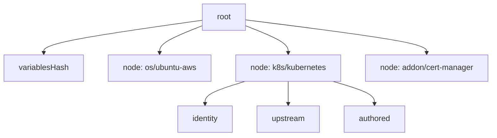

# The hashes and the root

This page tells how strata calculates the root. You do not need it to use
strata.

## Three hashes for each pack

A profile is a list of packs, in the order the profile stores them. Strata calculates three hashes for
each pack, so a report can say which part of a pack changed:

| Hash | Calculated from | Palette concept |
| --- | --- | --- |
| `identity` | the pack name, layer, type, tag, version, `packUid`, and `registryUid` | which pack build the layer references |
| `upstream` | the `digest` on the pack reference of the profile | the digest that Palette lists for the pack version: see [The pack-ref digest](./palette.md#the-pack-ref-digest) |
| `authored` | the canonical values, the content of each attached manifest, and the params | the configuration of the pack on the profile |

The [change flags](../reference/impact.md) `IDENTITY`, `UPSTREAM`, and
`AUTHORED` show which of the three hashes differ.

## The node hash and the root

```text
node = sha256(identity + upstream + authored)
root = sha256(variablesHash, [key, node] for each pack, in profile order)
```

`key` is `<layer>/<name>`. `variablesHash` covers the profile variables: the
configuration interface of each deployment. The variables are not part of a
pack, so they have their own hash.

The hash keeps a fixed set of fields of each variable, and drops the rest:

- the name, the display name, and the description
- the format, the default value, and the regex
- the flags `required`, `immutable`, `hidden`, and `isSensitive`
- the input type
- the label, the value, and the description of each option

It keeps no id. Strata sorts the variables by name before it hashes them, so the
order in which Palette lists them does not reach the hash either.

A sensitive variable arrives masked. Palette serves asterisks in place of the
secret, in the default value or in the option values. So the hash reads the
mask, and a change to the secret does not move the root.



The root and the node hashes form a Merkle tree. A change in any pack changes
its node hash, and so the root. Two profile versions with the same root are the
same release.

The root does not cover the uid, the name, the version, the project, the labels,
the cloud type, or the type of the profile. So the dev and prod copies of a
version, and a candidate and its published version, can have one root.

## When Palette does not serve the variables

A Palette that does not serve the variables endpoint answers `404` or `405`: see
[The Palette API](../reference/palette-api.md). Strata then reads the version as
one with no variables, and the root is the root of a version with no variables.
That root is correct for what strata read. It is not the root that the same
version gets from a Palette that serves the endpoint. So a record of a version
that has variables, written before such an upgrade, does not verify after it:
`verify` reports drift. A record of a version with no variables keeps its root.

The record holds `source.variablesUnavailable`, which is `true`, and `compare`
prints a note that names the side. Record the version again after the upgrade.

## The canonical form

The text of a value can change between two reads, in whitespace or in key order,
while its meaning does not. A text diff changes with each such rewrite. The
hashes do not. Strata reads the values and the manifests as YAML, and writes them as JSON
with sorted keys, before it calculates a hash.

A value that is not valid YAML, such as an unquoted Go template, gets another
treatment. Strata hashes the trimmed text, and the report says so. `--full`
prints a unified diff of the raw text for each changed value and for each changed
manifest, so such a value shows its change too.

## What the root does not cover

| Not hashed | Why |
| --- | --- |
| The pack schema and the presets | Palette does not store them on a profile. They belong to the pack version in the registry. A preset that a profile applies goes into the values, which `authored` covers. See [What Palette does](./palette.md#pack-schema-and-presets). |
| The values that a cluster gives its variables | They are the input of a run, not the release. Some are secrets. |
| The consumers, the fetch time, and the project | They describe a moment, not the release. |
| The uid of a manifest, and the digest Palette reports for it | Palette mints the uid for each copy. `authored` covers the name and the content hash of each manifest, sorted by name. |
| The annotations of a pack in the registry | Strata does not read them. |

## The content digest

The root answers "did this object change". A second question is "is this the
same version", and the root cannot always answer it: see
[Manifest pack uids](./palette.md#manifest-pack-uids). So two publishes of one definition can have two roots: when the definition holds
a manifest pack, or when the second publish takes a pack from another registry.

The content digest answers the second question:

```text
content = sha256("content/1", variablesHash,
                 [key, version, upstream, authored] for each pack, in profile order)
```

The input is a JSON object with sorted keys and no whitespace: `digest`,
`packs`, and `variables`. A change to what the digest covers is a new tag,
`content/2`. A test holds the digest of one fixture, so such a change is a
decision and not an accident.

It leaves out the tag, the pack uid, the registry uid, and the pack type. It
keeps `upstream`. So a pack that a team copies to another registry by digest
keeps its content digest. A pack with other bytes under the same version does
not.

| Case | The root | The content digest |
| --- | --- | --- |
| Two publishes of one definition, with a manifest pack or from another registry | different | equal |
| The same build under another tag name | different | equal |
| A pack copied to another registry by digest | different | equal |
| A pack from another kind of registry, with another archive | different | different |
| An edit of a value, a manifest, or a variable | different | different |
| Palette returns the values in another key order | equal | equal |
| The same packs in another order | different | different |
| A pack whose registry lists no digest, as two archives | equal | equal |

The last row is a gap, not a rule. Palette can list no digest for a pack: see
[What no run covers](./palette.md#what-no-run-covers). Then `upstreamSource` is
`none`, and neither digest covers the archive: two archives under that version
have one root. The knurl adapter refuses such a leaf, because nothing pins it by
content.

A tool that pins a profile version by digest pins the content digest. `verify`
keeps the root, because an edit in place is a change to one object.

## Two differences that are not content

The hash keeps two fields that can differ for the same content. Strata does not
drop them from the hash: then each root that exists changes, and the snapshot
needs a new schema id, `strata-snapshot/2`. `compare` and `same-release` recognize the
two cases instead.

| Case | Hash field | What strata does |
| --- | --- | --- |
| The same build under another tag name | `tag` in `identity` | `compare` marks the pack `tagRenamed` and says `SAME CONTENT`. `same-release` passes the pair. `verify` reports a rename in place as `DRIFT`. A hash without the tag misses that edit. |
| A manifest pack in two profiles | `packUid` in `identity`, which Palette gives each profile | `compare` marks the pack `mintedUidOnly` and says `SAME CONTENT`. `same-release` passes the pair. A pack from a registry keeps its `packUid`, which names the build of the registry. |

## Clusters

A cluster holds a copy of each profile version that it runs. Strata hashes each
copy exactly as it hashes the profile:

- The applied packs of the cluster replace the published packs.
- The manifests entry of the cluster for that profile replaces the manifests of
  the profile.
- The variable definitions come from the cluster.

So a cluster that runs a recorded version has the root of that record. The
cluster variables endpoint repeats the definition fields of the profile
endpoint, so the copy of a profile with a variable has the variables hash of the
profile: see [Cluster copies](./palette.md#cluster-copies). A cluster on a
version that pins other pack builds shows `IDENTITY`. An edit of the pack values
on the cluster, and a version that differs in values alone, each show
`AUTHORED`.

Without a profile selection, a cluster snapshot covers each applied profile in
canonical order. The cluster or infra profile comes first, then the others by
name. The packs of each profile keep their order. The variables are merged and
sorted by name. Palette lists the profiles of a cluster in an order that carries
no meaning: see
[The order of the profiles of a cluster](./palette.md#the-order-of-the-profiles-of-a-cluster).
So two clusters built from one definition have one merged root.

## The digest of each registry kind

`upstream` comes from the pack reference digest, or from the pack summary
digest when the reference has none. `hash.upstreamSource` in the snapshot says
which. Strata hashes the digest as Palette stores it, a Helm digest in bare hex
included. See
[What Palette does: the pack-ref digest](./palette.md#the-pack-ref-digest).
