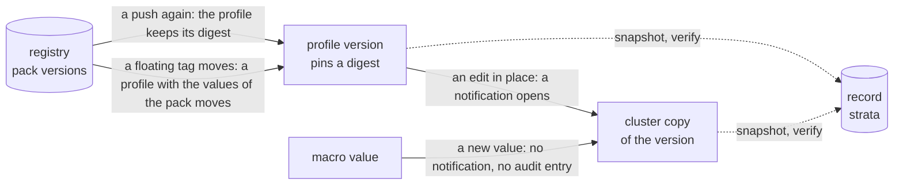

# What Palette does

Strata is built around the behavior of the Palette API. These pages state that
behavior, and what strata does with each part of it. The public documentation
describes each feature, and the behavior of the API under each change comes
from a live tenant: see
[The live example](../development/live-example.md). When a rule comes from the
code of Palette and not from a live run, the page says so. Each such rule that
no run checks is in
[What no run covers](palette/limits.md#what-the-source-of-palette-says).

Read these pages when you want to know why strata reports something the way it
does, or before you change how it reads a profile.

Each uid on these pages is an example. The pack names, the versions, and the
digests are real.

## The objects, and what can change each one

A registry holds pack versions. A profile version pins some of them, each with
a digest. A cluster runs its own copy of each profile version that it applies.
Each arrow in the diagram is a way that one object changes, and the label says
whether the object after it follows the change.

| Page | What it holds |
| --- | --- |
| [Packs and registries](palette/packs.md) | The digest on each pack reference, the digest of each registry kind, a pack pushed again, tag names, what a registry answers, pack states, and what a cluster installs of a Helm pack. |
| [Profiles](palette/profiles.md) | Edits in place, the audit log, version bumps, the lock of a cluster template, and macros. |
| [Clusters](palette/clusters.md) | The copies that a cluster holds, the order of its profiles, the tiers of a cluster record, the cluster listing, and a cluster on GCP. |
| [What no run covers](palette/limits.md) | The behaviors that no live run shows, and where the answers come from. |
