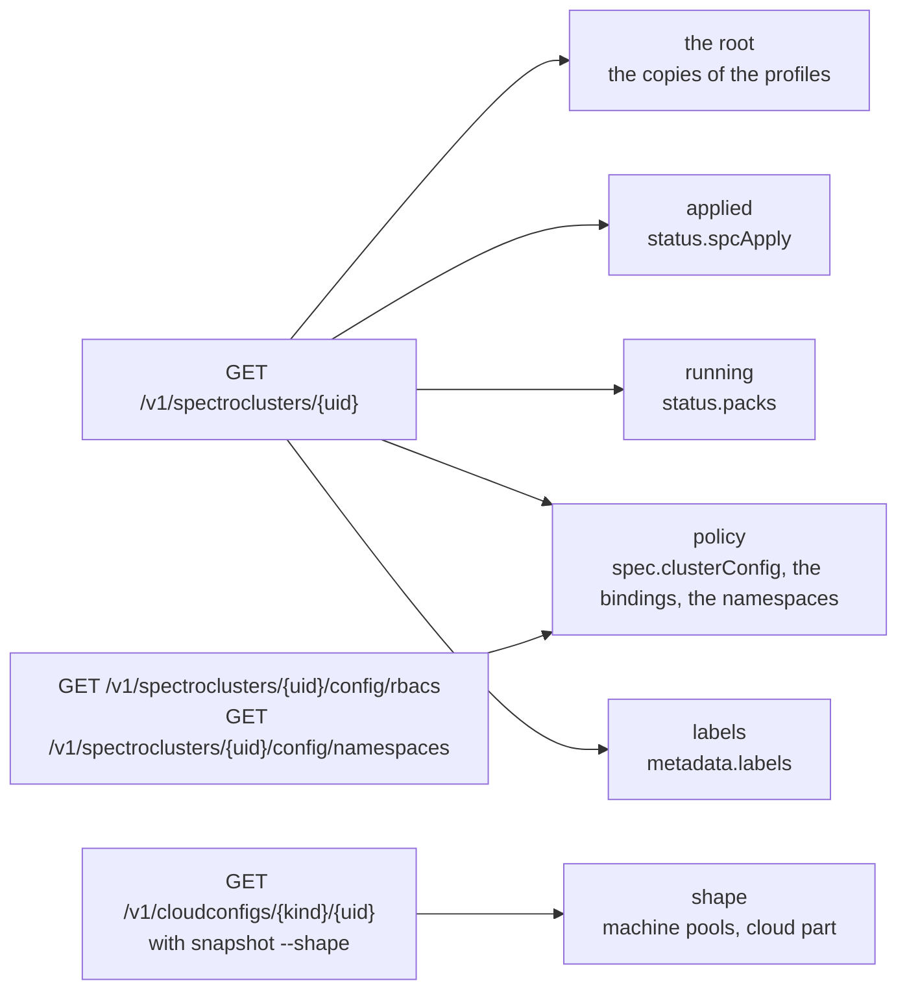
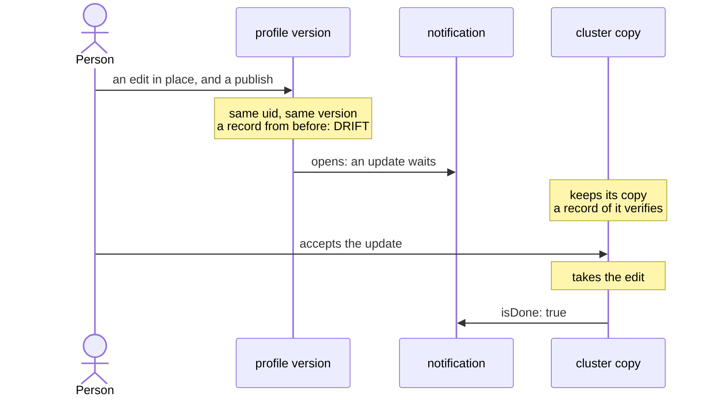

# Clusters

## Cluster tiers

Beside the copies of its profiles, the document of a cluster,
`GET /v1/spectroclusters/{uid}`, holds what Palette reports of the cluster
itself. A cluster on AWS gives these fields:

- `status.spcApply`: `spcHash` and `spcInfraHash`, two digests of 128 hex digits
  that Palette computes of the spec it applied, with `actionType`,
  `lastModifiedTime`, and `patchAppliedTime`. The field `crdDigest` is
  empty, and omitted, for a cluster of a built-in cloud; only a custom cloud
  type sets it.
- `status.packs[]`: each pack that the cluster reconciled, with `name`,
  `version`, `profileUid`, and a `condition` such as `InstallSuccess` or
  `PackServicesReady`.
- `spec.clusterConfig`: `machineManagementConfig.osPatchConfig`,
  `lifecycleConfig`, `machineHealthConfig`, `timezone`, `clusterResources`,
  `clusterRbac`, and the host and hybrid cluster config. `status.fips.mode` is
  beside it. Palette omits `updateWorkerPoolsInParallel`,
  `controlPlaneHealthCheckTimeout`, and `clusterMetaAttribute` when nobody set
  them: a cluster of the live example gives none of the three.
- `status.spcApply.actionType`: `DownloadAndInstall` for a cluster of the live
  example.
- `clusterResources` holds only references to the role bindings and the
  namespaces: a uid, a name, and a kind for each. The bindings and the
  namespaces are on routes of their own,
  `GET /v1/spectroclusters/{uid}/config/rbacs` and
  `GET /v1/spectroclusters/{uid}/config/namespaces`. Each answers `items`. A
  deleted cluster of the live example gives `{"items": []}` for each. For a
  uid that is not a cluster of the project, Palette answers HTTP 404 with the
  code `ResourceNotFound`. For the key of an active user with no role in the
  project, the bindings route answers HTTP 500, and not 403. The body holds the
  code `ResourceAccessDenied`, and a message that names the project.
- Palette takes an edit of the subjects of a binding through
  `PUT /v1/spectroclusters/{uid}/config/rbacs`, and the bindings route then
  gives the new subject. The edit also changes the `spcHash` of the cluster.
  Stage 5 of [tiers.sh](../../development/live-runs.md#tierssh) shows it.
- `metadata.labels`: the tags that the cluster was created with, as a map.
- `spec.cloudConfigRef`: the kind and uid of the cloud config, whose document,
  `GET /v1/cloudconfigs/{kind}/{uid}`, holds `spec.machinePoolConfig[]` and
  `spec.clusterConfig`.

The API reference of Palette gives each cloud type its own model of the cloud
config, with its own machine pool fields and cloud part fields. The cloud
config of AKS has the model of Azure, and that of GKE the model of GCP. The
cloud type of CloudStack is `apache-cloudstack`. On AWS,
each machine pool also gives `instanceConfig`, the CPUs and the memory of the
instance type, and `machinePoolProperties.archType`, such as `amd64`. See
[tiers.sh](../../development/live-runs.md#tierssh).

Palette omits a field that has no value. The AWS cluster of the live
example sets no override on a machine pool. So no pool of its cloud config holds
`overrideClusterAPIConfig`, `overrideHealthCheckConfiguration`, or
`overrideKubeadmConfiguration`. Its `spec.clusterConfig` holds `hybridConfig`,
`region`, and `sshKeyName`.

The API reference of Palette gives `overrideClusterAPIConfig` and
`overrideHealthCheckConfiguration` to each machine pool. A pool of the create
body holds them in `poolConfig`. Each pool of `spec.machinePoolConfig` of the
cloud config holds them as fields of the pool. The cloud config of an AWS
cluster also holds `overrideClusterAPIConfig` for the whole cluster, in
`spec.clusterConfig`. So the `shape` tier keeps the override of the cluster in
its cloud part, and the override of a pool in the pool. Stage 7 of
[tiers.sh](../../development/live-runs.md#tierssh) sets both overrides on a pool
of the live cluster, and shows where the cloud config holds each one.

On a managed engine, the `spec.clusterConfig` of the cloud config also holds
the control plane that the cloud runs. On EKS it holds `endpointAccess` and
`addons`. On GKE it holds `managedClusterConfig`, with the `location`, and
`overrideClusterAPIConfig`, the cluster API override of the cluster, such as
its release channel. A GKE machine pool has no zones: its `azs` is null. See
[eks.sh](../../development/live-runs.md#ekssh) and
[gke.sh](../../development/live-runs.md#gkesh).

Two clusters from one definition give one `spcInfraHash`, and each its own
`spcHash`. A change of the timezone and the labels of a cluster, through the
API, changes its `spcHash`. The other tiers of the two clusters are the same:
`status.packs`, `spec.clusterConfig`, the machine pools, and the labels. See
[tiers.sh](../../development/live-runs.md#tierssh).

Strata records these as tiers: see
[More of the cluster than its release](../../commands/snapshot/cluster.md#more-of-the-cluster-than-its-release).
It omits the times and the conditions, which change with no change of the
cluster. Between two clusters, the `applied` tier compares `spcInfraHash` alone.

## Cluster copies

Each cluster runs its own copy of the manifests of a profile. The copy keeps
the uid of the profile, and each manifest of it is a document with a uid of its
own. `GET /v1/spectroclusters/<uid>/profiles/packs/manifests` serves it.
A `cluster:<uid>` ref records that copy. **So a cluster record shows what the
cluster got, and not what its profile holds now.**

What follows from that, around an edit in place. The
`immutable-clusterprofiles` flag of the Spectro Cloud provider changes none of
it:

| Step | What Palette does |
| --- | --- |
| Edit a published version in place | The API takes it. With the flag, the provider refuses the same edit at plan time; without it, the provider plans an update in place. |
| A cluster that ran before the edit | Keeps its old copy. `verify` passes on its record, and the record of the version compares `IDENTICAL` with it. |
| The record of the version from before the edit | `verify` reports `DRIFT`. |
| A cluster created after the edit | Runs the edited content. A comparison of the two clusters shows the change, and notes that both sides are the same version. |
| The update pushed to the first cluster, with its notification left open | Its copy takes the edit within three minutes. |
| The update accepted on the first cluster | The two clusters match. The record from before the edit reports `DRIFT`. |

So `compare` of two cluster records shows a change exactly when the clusters run
different content, and strata needs no record of the updates that wait for a
cluster.

A copy has the variables of its profile too. `GET
/v1/spectroclusters/<uid>/variables` is an array with one entry for each applied
profile that declares a variable: the profile uid, and each variable with the
fields that the profile endpoint serves, plus `value`, the value the cluster
gives it. So the copy of a profile with a variable has the variables hash of the
profile, and its root equals the root of the profile. The value that a cluster
gives is in the record, under `source.cluster.variables`, and not in the root.

A change of that value is a change to the cluster, and not to the copy. The
Spectro Cloud provider sends it as `variables` of the profile on the cluster
resource. The audit log gets a new entry for the cluster, and its action says
who "updated the cluster variables on the cluster `<name>`". The variables endpoint
gives the new value. A record of the copy from before verifies, and a comparison
of the records from before and after reports the copy unchanged and one
variable value changed.

Palette says when a copy is behind its profile
([Cluster updates](https://docs.spectrocloud.com/clusters/cluster-management/cluster-updates/)).
`GET /v1/notifications/spectrocluster/<uid>` lists the notifications of a
cluster, newest first, with `items: null` when there are none. An edit in place
of a profile that the cluster runs opens one notification: `action.actionType`
is `NotifyActionClusterProfileUpdate`, `action.isDone` is `false`, and
`action.events` names the profile uid and each change:

| Change | Event `type` | `message` |
| --- | --- | --- |
| A manifest | `PackManifestUpdate` | `Manifest '<m>' is updated in the pack '
(
)'` |
| Pack values | `PackValuesUpdate` | `<display name> <pack> <version> values are updated` |

The update stops waiting when:

- The cluster takes the change, and the notification is done
  (`isDone: true`). A push of the content without `resolveNotification` closes
  the events of values and manifests that the push takes; the notification is
  done when no event is left. An event of a version, an added pack, or a
  removed pack stays until the cluster takes it.
- An edit gives the profile the content of the cluster's copy again. Palette
  removes each event that the edit undoes, and the notification with the last
  one. The cluster does not update.

A new version number alone, in place, opens no notification: the copy holds
the same content. A notification that is done stays in the list.

`GET /v1/spectroclusters/<uid>/profileUpdates` is no flag: it lists each profile
of the cluster also when no update waits. So strata reads the notifications,
and a cluster record says whether an update waits: see
[Whether an update waits](../../commands/snapshot/cluster.md#whether-an-update-waits). It is the content of the
update: `cluster:<uid>@pending` reads it. See
[The update that waits](other-objects.md#the-update-that-waits).

## The order of the profiles of a cluster

`spec.clusterProfileTemplates` of a cluster lists its profiles in the order the
request that made the cluster gave them. That order carries no meaning. Since
provider 0.28.1, the Spectro Cloud provider sends `cluster_profile` as a set,
hashed over the whole block with the profile uid in it. A new uid moves a
profile to another position. So two clusters built from one definition can list
the profiles in two orders. So strata orders them itself: a cluster record lists
the cluster or infra profile first and then the others by name, and merges their
packs in that order, so two clusters built from one definition have one merged
root. A check of what a cluster runs compares the set of profiles, and [the
knurl adapter](../../automation/knurl.md) gives the copies that a cluster holds by
name.

A `PUT` of a cluster's profiles in the other order, with the uids it has,
changes nothing: the document keeps the stored order. The audit log gets an
update of the cluster. So the order strata gives a cluster record
drops nothing that can change: the stored order is set when the cluster is
made, and stays.

That order is no install order either. No run establishes the install order of
the packs of two add-on profiles: see
[What no run covers](limits.md#what-no-run-covers).

The order of the packs inside a profile is no install order either. Each add-on
pack has an install priority: the key `spectrocloud.com/install-priority` under
`pack:` in its values, `0` unless set. The lowest value installs first. Packs
with one value install together, and the next value waits for their readiness
checks
([Install Order](https://docs.spectrocloud.com/profiles/cluster-profiles/create-cluster-profiles/create-addon-profile/#install-order)).
The priority is in the values, so the values hash and the root cover it, and a
change to it is an `AUTHORED` change. The list order is content because Palette
keeps it: two orders are two published versions.

## What the cluster listing answers

`GET /v1/dashboard/spectroclusters/meta` is the listing that `strata list
clusters` reads. **It names no profile.** Each entry holds:

| Part | Fields |
| --- | --- |
| `metadata` | `name`, `uid`, `creationTimestamp`, `lastModifiedTimestamp`, `deletionTimestamp`, the labels, and the annotations |
| `spec` | `cloudType`, `cloudAccountUid`, `cloudRegion`, `clusterType`, `archType`, `location`, and `tags` |
| `status` | `state` |

So the profiles that a cluster applies need the cluster document itself,
`GET /v1/spectroclusters/{uid}`, and its `spec.clusterProfileTemplates`. That is
one request for each cluster, which is why `strata list clusters --applied` asks
for them and a plain `strata list` does not.

The listing names no health either, and neither does the cluster document. The
cluster summary, `GET /v1/dashboard/spectroclusters/{uid}`, gives
`status.health.state`: `Healthy` or `UnHealthy`, with the conditions that made
it so. [The knurl adapter](../../automation/knurl.md) reads it there.

## An imported cluster

The listing gives each cluster a `clusterType`. `PureManage` is a cluster that
Palette built. `AlloyMonitor`, `AlloyAssist`, and `AlloyExtend` are the types
of a cluster that a person imported. They mean no cloud account, a cloud
account, and the extensions of Palette. The listing gives cluster A of the live
example `PureManage`: see
[The type of a cluster that Palette builds](../../development/live-runs.md#the-type-of-a-cluster-that-palette-builds).

A person imports a cluster in read-only mode or in full permission mode. In
read-only mode Palette applies no add-on profile to the cluster. In full
permission mode it applies add-on profiles, and in no mode a cluster profile
([Imported clusters](https://docs.spectrocloud.com/clusters/imported-clusters/)).

The listing gives no import mode: the console shows it. So the row of
`strata list clusters --applied` says only that the cluster is imported, when it
has no profile. No run imports a cluster: see
[What no run covers](limits.md).

The consumer list of a profile version, `status.inUseClusters`, is what Palette
computes when it is asked: in the project of the request, or in every project at
tenant scope. It names virtual clusters, and no deleted cluster. When Palette
cannot compute it, the list comes back empty, with no error in the answer. So
`consumers` asks the cluster search as well, and names a cluster that applies
the version and is not in the list.

**The listing omits each virtual cluster.** A virtual cluster has the cloud
type `nested`, and the listing has no cluster of that cloud type. The search
omits them too, unless a condition asks for the environment `nested`. Then
it gives them, with the cluster group and the host cluster of each in
`status.virtual`.

So `list clusters` and `cluster:<name>` send the search with that one
condition, in the scope of the listing. A query sends the search a second time,
with the condition added. The checks `member-listed`, `member-listed-group`,
and `member-by-name` of `cluster-group.sh` show it on a live tenant.
`list clusters` names the virtual cluster beside its host cluster, with its
group and its host in `virtual`. `cluster:<name>` of the virtual cluster
resolves to its uid. See
[cluster-group.sh](../../development/live-runs.md#cluster-groupsh).

The listing answers a JSON array at the top level, and not an object with
`items` ([Palette API reference](https://docs.spectrocloud.com/api/v1/)). Strata
reads both shapes.

**The search.** `POST /v1/dashboard/spectroclusters/search` is the listing that
Palette recommends. `GET .../search/schema` names the properties it takes,
`tags` among them. It gives each cluster with its labels, and a summary with the
cloud, the project by name and uid, and the profiles that the cluster runs, and
no `spec`. At tenant scope it searches
every project the key can read. It pages on `listmeta.continue`, 50 to a page.

**Tags are labels.** The provider writes `tags = ["env:prod"]` into
`metadata.labels` as `env=prod`, and a tag with no colon, `prod`, as
`prod=spectro__tag`. The search reads a value of `tags` as `<key>:<value>`, or
as `<key>` for a label that must be there, with the operator `eq`. The listing
and the cluster document carry the same labels.

**Saved tag filters** belong to the tenant: `GET /v1/filters/metadata?filterType=tag`
lists them, and `GET /v1/filters/tag/{uid}` gives the conditions of one. The
search takes no filter uid, so strata turns the conditions into a search. The
code of Palette gives the rest: a key with no value means the label is
there, `negation` turns a condition with values over, and the search lists no
virtual cluster unless its filter asks for the environment `nested`.

**The search by profile.** The property `clusterProfiles` takes the name of a
profile, and not its uid. Palette changes each name into the uids of every
profile with that name, with no scope, and then selects the clusters in the
scope of the request that run one of those uids. A value that is not the name
of a profile selects no cluster, so a search with the uid of a profile answers
nothing. So a search with `clusterProfiles eq <name>` gives the clusters that
run any version of the profile, and the same search with `environment eq
nested` gives the virtual clusters whose own profiles include it. It does not
give a virtual cluster that runs the version through its cluster group: the
search reads a summary of each cluster, and the summary of such a virtual
cluster does not name the profiles of its group. So `consumers` also reads the
virtual clusters of each cluster group that pins the version. The item of a cluster does not say which
version it runs: on a live tenant, `specSummary.clusterProfileTemplates` is
empty. So strata reads the document of each cluster that the search names, and
keeps the clusters that run the version. The checks `search-profile-runs`,
`search-nested-misses-member`, `member-consumer-group`, and
`group-virtual-clusters` of `cluster-group.sh` show it on a live tenant: see
[cluster-group.sh](../../development/live-runs.md#cluster-groupsh).

## A deleted cluster

A deleted cluster leaves this listing and keeps its document:
`GET /v1/spectroclusters/<uid>` still answers `200`, with the state `Deleted`.
Strata resolves `cluster:<name>` through the listing and the search of the
virtual clusters. So the name does not go ambiguous when one cluster is deleted
and built again.

A deletion through the API behaves in the same way. `DELETE
/v1/spectroclusters/<uid>` is accepted at once. While the cluster goes, the
listing keeps it with the state `Deleting`, and `consumers` lists it with that
state and exits `1`. After, the listing drops it, the document reports
`Deleted`, and `consumers` lists nothing and exits `0`. An apply of the Spectro
Cloud provider then holds no cluster in the OpenTofu state.

The code of Palette gives the rest of the document. The delete sets
`metadata.isDeleted` to `true`, the time in `metadata.deletionTimestamp`, and
the annotation `deleted`, and keeps the spec. So `verify` of a record of the
cluster says `DRIFT: cluster <c> no longer exists: deleted <time>`, and not
`OK`. The states of a cluster are `Pending`, `Provisioning`, `Running`,
`Deleting`, `Deleted`, `Error`, `Importing`, `Adopting`, `Unknown`, `Paired`,
and `Pairing`. `verify` ends its verdict with each state that is not
`Running`. An edge host has the state `ready`, `unpaired`, or `in-use`, and a
cluster group has `status.isActive`. A 404 for the uid of an edge host or a
cluster group means that Palette no longer has it.

## The CAPA stack of an AWS account

Before Palette builds the cloud infrastructure of an AWS cluster, it applies a
CloudFormation stack to the account: `cluster-api-provider-aws-sigs-k8s-io`.
The stack holds six CAPA roles, four managed policies, and three instance
profiles. One stack serves each AWS cluster of the account.

Palette updates the stack at the first create after an upgrade of Palette. It
writes the tag `palette-version` on each role of the stack. One account shows
`4.9.24`, then `4.10.4`, then `4.10.12`. So the tag tells which release applied
the stack last. The updates of `4.9.24` and `4.10.4` changed only tags.

The update of `4.10.12` also changed the trust policy of the roles. That change
needs `iam:UpdateAssumeRolePolicy`, and the documented core policies of Palette
do not grant it. AWS refused the update with `AccessDenied`. Then AWS refused
the rollback for the same reason, and the stack stayed in
`UPDATE_ROLLBACK_FAILED`.

A stack in that state stops each AWS create of the account. Palette sends
`UpdateStack` again and again, and AWS refuses each one with `ValidationError`:
"is in UPDATE_ROLLBACK_FAILED state and can not be updated". The cluster stays
`Provisioning`, and no condition is `False`: the step
`CloudInfrastructureReady` does not start. Only the events of the cluster say
why. The documented policies do not grant `cloudformation:ContinueUpdateRollback`
or `cloudformation:DeleteStack`, so Palette cannot recover by itself. An
administrator of the account must continue the rollback, or delete the stack so
that Palette makes it again.

The rule `capa-manual-stack` describes the other way. With
`manageCloudFormationStackManually.enabled: true` in the values of the
Kubernetes pack, Palette makes no stack, and the roles and the instance
profiles must exist before the create. The landing zone of the account can own
them, so that a create does not change them. No live run shows this way yet.

`strata preflight` checks the stack before a build. `capa-bootstrap-stack`
reads its state, `capa-stack-update-denied` simulates the IAM actions of an
update, and `capa-stack-release-behind` compares the release in the tag with
`--release`. See
[After an upgrade of Palette](../../use-cases/stop-a-build.md#after-an-upgrade-of-palette).

## A cluster on GCP

A GCP cluster takes its node image from the project `spectro-image-build` of
Spectro Cloud, one image for each pair of OS and Kubernetes versions, such as
`u-2404-0-k-1356-0` for Ubuntu 24.04 and Kubernetes 1.35.6. Spectro Cloud shares
some of these images and not others: the image of Kubernetes 1.36.2 is not
shared, and that Kubernetes pack lists `gcp`. Palette takes such a profile and
such a cluster. The cluster then stays `Provisioning`, and each
attempt to make a machine fails with
`Required 'compute.images.useReadOnly' permission`.

The nodes of a GCP cluster run as the Compute Engine default service account of
the project, and the GCE cloud controller in the cluster calls the Compute API
with it. Without a role for that account on the project, the cloud controller
exits, the node keeps the taint `node.cloudprovider.kubernetes.io/uninitialized`,
no other pod starts, and the cluster stays `Provisioning` with its control plane
instance running. The cluster continues when the account gets
`roles/compute.admin`.

Strata reads a GCP cluster and its profiles with no change: see
[A second cloud: GCP](../../development/live-runs.md#a-second-cloud-gcp).
