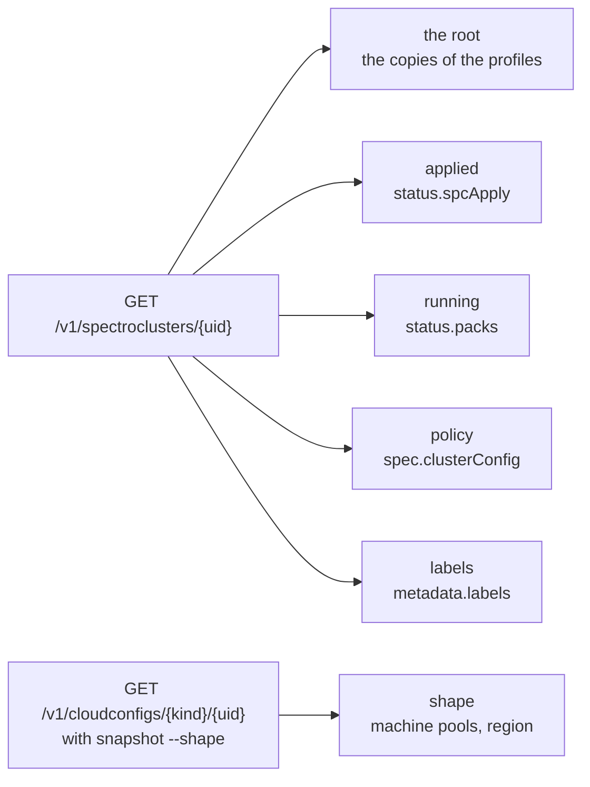
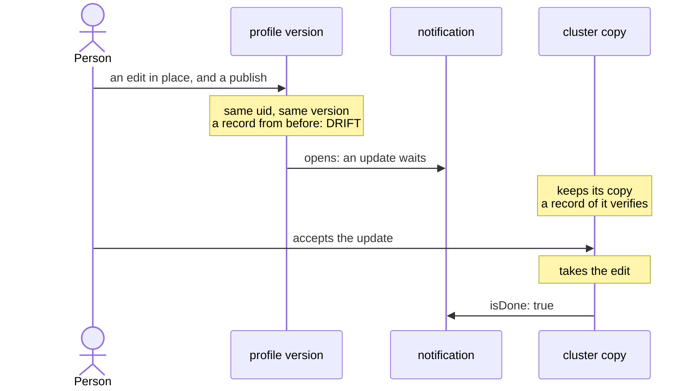

# Clusters

## Cluster tiers

Beside the copies of its profiles, the document of a cluster,
`GET /v1/spectroclusters/{uid}`, holds what Palette reports of the cluster
itself. A cluster on AWS gives these fields:

- `status.spcApply`: `spcHash` and `spcInfraHash`, two digests of 128 hex digits
  that Palette computes of the spec it applied, with `actionType`,
  `lastModifiedTime`, and `patchAppliedTime`. The document has no field
  `crdDigest`.
- `status.packs[]`: each pack that the cluster reconciled, with `name`,
  `version`, `profileUid`, and a `condition` such as `InstallSuccess` or
  `PackServicesReady`.
- `spec.clusterConfig`: `machineManagementConfig.osPatchConfig`,
  `lifecycleConfig`, `machineHealthConfig`, `timezone`, `clusterResources`,
  `clusterRbac`, and the host and hybrid cluster config. `status.fips.mode` is
  beside it.
- `metadata.labels`: the tags that the cluster was created with, as a map.
- `spec.cloudConfigRef`: the kind and uid of the cloud config, whose document,
  `GET /v1/cloudconfigs/{kind}/{uid}`, holds `spec.machinePoolConfig[]` and
  `spec.clusterConfig`.

Two clusters from one definition give one `spcInfraHash`, and each its own
`spcHash`. A change of the timezone and the labels of a cluster, through the
API, changes its `spcHash`. The other tiers of the two clusters are the same:
`status.packs`, `spec.clusterConfig`, the machine pools, and the labels. See
[tiers.sh](../../development/live-runs.md#tierssh).

Strata records these as tiers: see
[More of the cluster than its release](../../commands/snapshot.md#more-of-the-cluster-than-its-release).
It leaves out the times and the conditions, which change with no change of the
cluster. Between two clusters, the `applied` tier compares `spcInfraHash` alone.

## Cluster copies

Each cluster runs its own copy of the manifests of a profile. The copy has its
own uid, and `GET /v1/spectroclusters/<uid>/profiles/packs/manifests` serves it.
A `cluster:<uid>` ref records that copy. **So a cluster record shows what the
cluster got, and not what its profile holds now.**

What follows from that, around an edit in place. The
`immutable-clusterprofiles` flag of the Spectro Cloud provider changes none of
it:

| Step | What Palette does |
| --- | --- |
| Edit a published version in place | The API accepts it. With the flag, the provider refuses the same edit at plan time; without it, the provider plans an update in place. |
| A cluster that ran before the edit | Keeps its old copy. `verify` passes on its record, and the record of the version compares `IDENTICAL` with it. |
| The record of the version from before the edit | `verify` reports `DRIFT`. |
| A cluster created after the edit | Runs the edited content. A comparison of the two clusters shows the change, and notes that both sides are the same version. |
| The update pushed to the first cluster, with its notification left open | Its copy takes the edit within three minutes. |
| The update accepted on the first cluster | The two clusters match. The record from before the edit reports `DRIFT`. |

So `compare` of two cluster records shows a change exactly when the clusters run
different content, and strata needs no record of the updates that wait for a
cluster.

A copy has the variables of its profile too. `GET
/v1/spectroclusters/<uid>/variables` is an array with one entry for each applied
profile that declares a variable: the profile uid, and each variable with the
fields that the profile endpoint serves, plus `value`, the value the cluster
gives it. So the copy of a profile with a variable has the variables hash of the
profile, and its root equals the root of the profile. The value that a cluster
gives is in the record, under `source.cluster.variables`, and not in the root.

A change of that value is a change to the cluster, and not to the copy. The
Spectro Cloud provider sends it as `variables` of the profile on the cluster
resource. The audit log gets a new entry for the cluster, and its action says
who "updated the cluster variables on the cluster `<name>`". The variables endpoint
gives the new value. A record of the copy from before verifies, and a comparison
of the records from before and after reports the copy unchanged and one
variable value changed.

Palette says when a copy is behind its profile
([Cluster updates](https://docs.spectrocloud.com/clusters/cluster-management/cluster-updates/)).
`GET /v1/notifications/spectrocluster/<uid>` lists the notifications of a
cluster, newest first, with `items: null` when there are none. An edit in place
of a profile that the cluster runs opens one notification: `action.actionType`
is `NotifyActionClusterProfileUpdate`, `action.isDone` is `false`, and
`action.events` names the profile uid and each change:

| Change | Event `type` | `message` |
| --- | --- | --- |
| A manifest | `PackManifestUpdate` | `Manifest '<m>' is updated in the pack '
(
)'` |
| Pack values | `PackValuesUpdate` | `<display name> <pack> <version> values are updated` |

The notification is done (`isDone: true`) when:

- The cluster takes the change. A push of the content without
  `resolveNotification` closes it too.
- An edit gives the profile the content of the cluster's copy again. The
  cluster does not update.

A new version number alone, in place, opens no notification: the copy holds
the same content. A notification that is done stays in the list.

`GET /v1/spectroclusters/<uid>/profileUpdates` is no flag: it lists each profile
of the cluster also when no update waits. So strata reads the notifications,
and a cluster record says whether an update waits: see
[Whether an update waits](../../commands/snapshot.md#whether-an-update-waits).

## The order of the profiles of a cluster

`spec.clusterProfileTemplates` of a cluster lists its profiles in the order the
request that made the cluster gave them. That order carries no meaning. Since
provider 0.28.1, the Spectro Cloud provider sends `cluster_profile` as a set,
hashed over the whole block with the profile uid in it. A new uid moves a
profile to another position. So two clusters built from one definition can list
the profiles in two orders. So strata orders them itself: a cluster record lists
the cluster or infra profile first and then the others by name, and merges their
packs in that order, so two clusters built from one definition have one merged
root. A check of what a cluster runs compares the set of profiles, and [the
knurl adapter](../../automation/knurl.md) gives the copies that a cluster holds by
name.

A `PUT` of a cluster's profiles in the other order, with the uids it has,
changes nothing: the document keeps the stored order. The audit log gets an
update of the cluster. So the order strata gives a cluster record
drops nothing that can change: the stored order is set when the cluster is
made, and stays.

That order is no install order either. No run establishes the install order of
the packs of two add-on profiles: see
[What no run covers](limits.md#what-no-run-covers).

The order of the packs inside a profile is no install order either. Each add-on
pack has an install priority: the key `spectrocloud.com/install-priority` under
`pack:` in its values, `0` unless set. The lowest value installs first. Packs
with one value install together, and the next value waits for their readiness
checks
([Install Order](https://docs.spectrocloud.com/profiles/cluster-profiles/create-cluster-profiles/create-addon-profile/#install-order)).
The priority is in the values, so the values hash and the root cover it, and a
change to it is an `AUTHORED` change. The list order is content because Palette
keeps it: two orders are two published versions.

## What the cluster listing answers

`GET /v1/dashboard/spectroclusters/meta` is the listing that `strata list
clusters` reads. **It names no profile.** Each entry holds:

| Part | Fields |
| --- | --- |
| `metadata` | `name`, `uid`, `creationTimestamp`, `lastModifiedTimestamp`, `deletionTimestamp`, the labels, and the annotations |
| `spec` | `cloudType`, `cloudAccountUid`, `cloudRegion`, `clusterType`, `archType`, `location`, and `tags` |
| `status` | `state` |

So the profiles that a cluster applies need the cluster document itself,
`GET /v1/spectroclusters/{uid}`, and its `spec.clusterProfileTemplates`. That is
one request for each cluster, which is why `strata list clusters --applied` asks
for them and a plain `strata list` does not.

The listing names no health either, and neither does the cluster document. The
cluster summary, `GET /v1/dashboard/spectroclusters/{uid}`, gives
`status.health.state`: `Healthy` or `UnHealthy`, with the conditions that made
it so. [The knurl adapter](../../automation/knurl.md) reads it there.

The consumer list of a profile version, `status.inUseClusters`, is what Palette
computes when it is asked, in the projects the key can read. So `consumers`
reads each cluster the key can list as well, and names a cluster that applies
the version and is not in the list.

The listing answers a JSON array at the top level, and not an object with
`items` ([Palette API reference](https://docs.spectrocloud.com/api/v1/)). Strata
reads both shapes.

A deleted cluster leaves this listing and keeps its document:
`GET /v1/spectroclusters/<uid>` still answers `200`, with the state `Deleted`.
So `cluster:<name>`, which strata resolves through the listing, does not go
ambiguous when one name is deleted and built again.

A deletion through the API behaves in the same way. `DELETE
/v1/spectroclusters/<uid>` is accepted at once. While the cluster goes, the
listing keeps it with the state `Deleting`, and `consumers` lists it with that
state and exits `1`. After, the listing drops it, the document reports
`Deleted`, and `consumers` lists nothing and exits `0`. An apply of the Spectro
Cloud provider then holds no cluster in the OpenTofu state.

## A cluster on GCP

A GCP cluster takes its node image from the project `spectro-image-build` of
Spectro Cloud, one image for each pair of OS and Kubernetes versions, such as
`u-2404-0-k-1356-0` for Ubuntu 24.04 and Kubernetes 1.35.6. Spectro Cloud shares
some of these images and not others: the image of Kubernetes 1.36.2 is not
shared, although that Kubernetes pack lists `gcp`. Palette accepts such a
profile and such a cluster. The cluster then stays `Provisioning`, and each
attempt to make a machine fails with
`Required 'compute.images.useReadOnly' permission`.

The nodes of a GCP cluster run as the Compute Engine default service account of
the project, and the GCE cloud controller in the cluster calls the Compute API
with it. Without a role for that account on the project, the cloud controller
exits, the node keeps the taint `node.cloudprovider.kubernetes.io/uninitialized`,
no other pod starts, and the cluster stays `Provisioning` with its control plane
instance running. The cluster continues when the account gets
`roles/compute.admin`.

Strata reads a GCP cluster and its profiles with no change: see
[A second cloud: GCP](../../development/live-runs.md#a-second-cloud-gcp).
