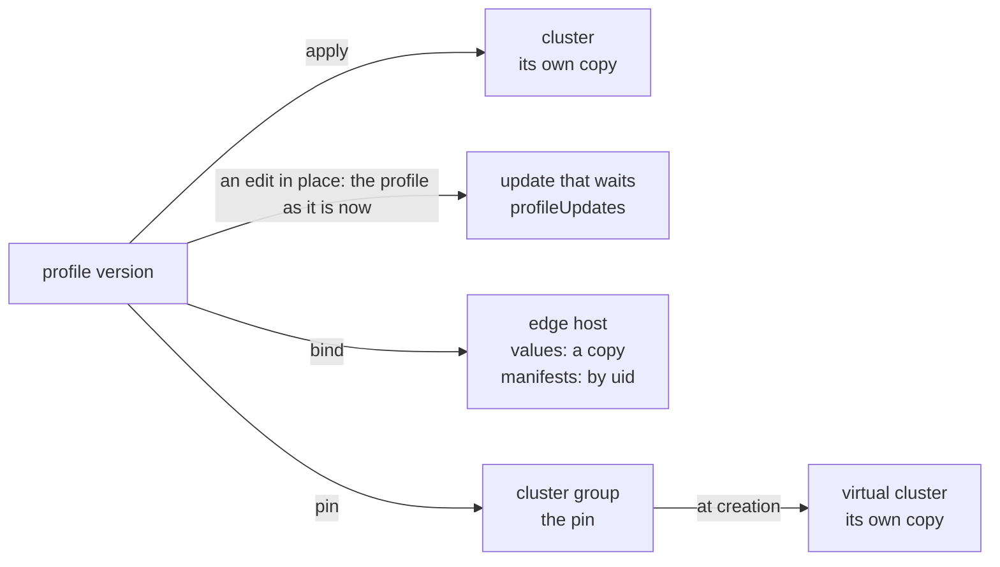

# Edge hosts, cluster groups, and app profiles

A cluster is not the only object of Palette that holds profiles. An edge host,
a cluster group, and the update that waits for a cluster hold them in the shape
of `spec.clusterProfileTemplates`, which a cluster record already reads. An app
profile holds tiers, which are close to packs. This page states what each one
holds, and what an edit in place does to it.

## The update that waits

`GET /v1/spectroclusters/<uid>/profileUpdates` gives `profiles[]`, each a
profile template in the shape of `spec.clusterProfileTemplates`:

- It lists each profile of the cluster, also when no update waits. Then each
  entry is the copy that the cluster runs, and a record of
  `cluster:<uid>@pending` has the root of the cluster.
- After an edit in place of a profile, the entry of that profile is the profile
  as it is now, and a record of `@pending` has another root. Compare of the
  cluster with `@pending` names the pack that the edit changed, and no other: a
  manifest of the add-on version, or one value of the CSI pack of the release
  version.
- When the cluster takes the update, it runs the root of the pending record.
- Palette masks the sensitive values in the answer. When nothing waits, the
  pending record and the cluster record have one root all the same.

The code of Palette gives the rule: Palette puts the profile as it is now
in place of each profile that the open notification names, and keeps the other
profiles of the cluster.

## Edge hosts

`GET /v1/edgehosts/<uid>` gives the profiles bound to an edge host in
`spec.clusterProfileTemplates`. `PUT /v1/edgehosts/<uid>/profiles` binds them,
and Palette does not check the type of the profile. An edge host that is
registered with no device is in state `unpaired`, and holds its profiles all the
same.

- **The values are a copy.** An edit in place of a value of the profile does not
  reach the edge host: the template of the host keeps the value from before.
- **Each manifest is a copy too.** Palette copies each manifest when it binds
  the profile, under a uid of its own. The template of the host names the copy
  by that uid, with no content, and
  `GET /v1/edgehosts/<uid>/pack/manifests/<manifest uid>` gives its content.
  An edit in place of the profile does not reach the copy, as it does not reach
  the copy of a cluster. Strata reads each copy by its uid.
- `POST /v1/dashboard/edgehosts/search` lists the edge hosts, with a summary of
  each template: uid, name, and version. `GET /v1/edgehosts/metadata` lists
  them with no profiles.
- `status.inUseClusters` of a profile names clusters and never an edge host. So
  `consumers` searches the edge hosts.

## Cluster groups

A cluster group pins add-on profiles for its virtual clusters in
`spec.clusterProfileTemplates`. The profiles go to the virtual clusters, and not
to the host clusters of the group.

- A virtual cluster that is created in the group runs the pinned profiles in its
  own `spec.clusterProfileTemplates`, with its own copy of each manifest.
- The template of the group names its own copy of each manifest by a uid of
  its own, with no content, as an edge host does.
  `GET /v1/clusterprofiles/<profile uid>/packs/<pack>/manifests/<manifest uid>`
  gives the content of a copy. After an edit in place of a manifest of a pinned
  profile, the group and its member keep their copies, and still agree.
- `status.inUseClusters` of the pinned profile names the virtual cluster. The
  cluster listing, `GET /v1/dashboard/spectroclusters/meta`, does not list it.
  So `consumers` finds a virtual cluster through the consumer list of Palette.
  Its second reading asks the cluster search with the environment `nested`,
  so it finds a virtual cluster that the list omits too: see
  [The search by profile](clusters.md#what-the-cluster-listing-answers).
  `list clusters` does not show a virtual cluster.
- `POST /v1/dashboard/clustergroups/<uid>/virtualClusters` lists the virtual
  clusters of a group. `GET /v1/clustergroups/hostCluster/metadata` gives the
  name and the uid of each group.
- `spec.clustersConfig` of the group is the config that the group gives each
  virtual cluster: `endpointType`, `kubernetesDistroType`, `limitConfig`,
  `values`, and `hostClustersConfig[]`. `limitConfig` gives each limit in two
  units: `cpu` in cores and `cpuMilliCore`, and `memory` and `memoryMiB`, with
  the same value. `values` is YAML with its comments. Each entry of
  `hostClustersConfig[]` has the `clusterUid` and the `endpointConfig` of a
  host cluster.
- The live run gives a virtual cluster a CPU limit of 3 cores. The API sets no
  lower limit: it checks a virtual cluster against the upper limits of the
  group alone.

## App profiles

An app profile holds tiers: `GET /v1/appProfiles/<uid>/tiers` gives each tier
with its type, version, source tier, registry, values, properties, and
manifests. The content of a manifest comes from
`GET /v1/appProfiles/<uid>/tiers/<tierUid>/manifests/<manifestUid>`, with a
`digest` of the content.

- A plain update of a tier changes the app profile. The uid and the version
  stay, and no new version appears: an app profile has no publish step.
- `spec.installOrder` of a tier is the order in which Palette installs the
  tiers. Palette does not give the field for a tier whose order is 0, and it
  does not list the tiers in install order. The code of Palette gives these
  two rules.
- An app profile that is made with an install order on each tier keeps the
  orders, and the tiers route gives them. The document of the app profile gives
  no order. A plain update of a tier with another order,
  `PUT /v1/appProfiles/<uid>/tiers/<tierUid>`, gets a 2xx answer, and the tier
  keeps its order. [app-profile.sh](../../development/live-runs.md#app-profilesh)
  shows it.
- `spec.containerRegistryUid` of a container tier is the registry of its image.
  Palette does not give the field when the tier names no registry.
- A tier has no digest of its chart or its operator, so a record of an app
  profile cannot show a push again under one version.
- `status.inUseApps` of `GET /v1/appProfiles/<uid>` names the app deployments
  that use the app profile version, each with `uid`, `name`, `projectUid`, and
  `kind`. Palette computes the list when it is asked: each app deployment that
  is not deleted and whose `spec.profile.metadata.uid` is the version, in the
  projects the key can read. The code of Palette gives this rule.
- `GET /v1/appDeployments/<uid>` gives one app deployment: the version its copy
  names in `spec.profile.metadata.version`, and its state in `status.state`:
  `Pending`, `Deploying`, `Deployed`, or `Updating`.
- Palette refuses the delete of an app profile while an app deployment uses it.
  The code of Palette gives this rule. The check reads the
  deployments of all projects, and not only those the key can read. So a
  deployment that the key cannot read is not in `status.inUseApps`, and it
  still stops the delete. `consumers` reads the list:
  [consumers](../../commands/consumers.md#app-profiles).
- The dashboard route of the app deployments, `POST /v1/dashboard/appDeployments`,
  filters by name, cluster, and tag, and not by profile. So `consumers` does no
  second reading for an app profile.

A live run shows each rule on this page, except a rule that comes from the
code of Palette. See
[What the live example verifies](../../development/live-runs.md).
