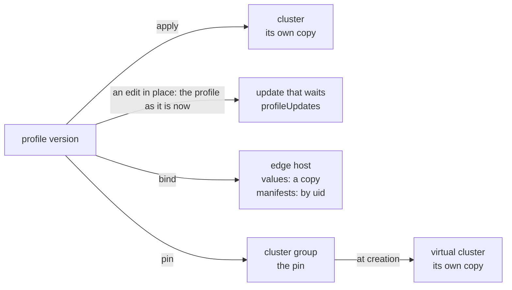

# Edge hosts, cluster groups, and app profiles

A cluster is not the only object of Palette that holds profiles. An edge host,
a cluster group, and the update that waits for a cluster hold them in the shape
of `spec.clusterProfileTemplates`, which a cluster record already reads. An app
profile holds tiers, which are close to packs. This page states what each one
holds, and what an edit in place does to it.

## The update that waits

`GET /v1/spectroclusters/<uid>/profileUpdates` gives `profiles[]`, each a
profile template in the shape of `spec.clusterProfileTemplates`:

- It lists each profile of the cluster, also when no update waits. Then each
  entry is the copy that the cluster runs, and a record of
  `cluster:<uid>@pending` has the root of the cluster.
- After an edit in place of a profile, the entry of that profile is the profile
  as it is now, and a record of `@pending` has another root. Compare of the
  cluster with `@pending` names the pack that the edit changed, and no other: a
  manifest of the add-on version, or one value of the CSI pack of the release
  version.
- When the cluster takes the update, it runs the root of the pending record.
- Palette masks the sensitive values in the answer. When nothing waits, the
  pending record and the cluster record have one root all the same.

The Spectro Cloud source gives the rule: Palette puts the profile as it is now
in place of each profile that the open notification names, and keeps the other
profiles of the cluster.

## Edge hosts

`GET /v1/edgehosts/<uid>` gives the profiles bound to an edge host in
`spec.clusterProfileTemplates`. `PUT /v1/edgehosts/<uid>/profiles` binds them,
and Palette does not check the type of the profile. An edge host that is
registered with no device is in state `unpaired`, and holds its profiles all the
same.

- **The values are a copy.** An edit in place of a value of the profile does not
  reach the edge host: the template of the host keeps the value from before.
- **A manifest is not.** The template of the host names each manifest by its
  uid, with no content. An edit in place keeps the uid of a manifest, so the
  edge host gets the edited manifest, and a record of it drifts. A cluster keeps
  its own copy of the manifest.
- `POST /v1/dashboard/edgehosts/search` lists the edge hosts, with a summary of
  each template: uid, name, and version. There is no `GET` listing.
- `status.inUseClusters` of a profile names clusters and never an edge host. So
  `consumers` searches the edge hosts.

## Cluster groups

A cluster group pins add-on profiles for its virtual clusters in
`spec.clusterProfileTemplates`. The profiles go to the virtual clusters, and not
to the host clusters of the group.

- A virtual cluster that is created in the group runs the pinned profiles in its
  own `spec.clusterProfileTemplates`, with its own copy of each manifest.
- The template of the group names each manifest by its uid, with no content, as
  an edge host does. So after an edit in place of a manifest of a pinned
  profile, a record of the group drifts, and the group and its member differ:
  the member keeps its copy.
- `status.inUseClusters` of the pinned profile names the virtual cluster. The
  cluster listing, `GET /v1/dashboard/spectroclusters/meta`, does not list it.
  So `consumers` finds a virtual cluster through the consumer list of Palette,
  and its second reading cannot find one that the list omits. `list clusters`
  does not show a virtual cluster.
- `POST /v1/dashboard/clustergroups/<uid>/virtualClusters` lists the virtual
  clusters of a group. `GET /v1/clustergroups/hostCluster/metadata` gives the
  name and the uid of each group.
- Palette refuses a virtual cluster with a CPU limit under 3 cores.

## App profiles

An app profile holds tiers: `GET /v1/appProfiles/<uid>/tiers` gives each tier
with its type, version, source tier, registry, values, properties, and
manifests. The content of a manifest comes from
`GET /v1/appProfiles/<uid>/tiers/<tierUid>/manifests/<manifestUid>`, with a
`digest` of the content.

- A plain update of a tier changes the app profile. The uid and the version
  stay, and no new version appears: an app profile has no publish step.
- A tier has no digest of its chart or its operator, so a record of an app
  profile cannot show a push again under one version.
- `status.inUseApps` names the app deployments that use the app profile. They
  are not clusters, so `consumers` does not read them.

A live run shows each rule on this page that does not name the source. See
[What the live example verifies](../../development/live-runs.md).
