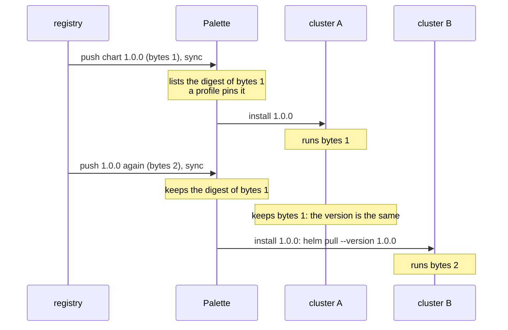

# Packs and registries

## The pack-ref digest

On a published profile, the `digest` that Palette puts on each pack reference is
the digest that Palette lists for that pack version. For a pack in an OCI pack
registry, that digest is the manifest digest of the push. It is the same for a
chart in an OCI Helm registry.

| Pack | Type, registry | Version | Pack-ref digest | What the digest is |
| --- | --- | --- | --- | --- |
| ubuntu-aws | `spectro`, pack registry | 24.04 | `sha256:2df05daa4eb4...` | the digest of the pack registry for the version, as Palette lists it |
| kubernetes | `spectro`, pack registry | 1.36.2 | `sha256:c4f7f20f40c7...` | the same |
| cni-cilium-oss | `spectro`, pack registry | 1.20.1 | `sha256:917d9de9a696...` | the same |
| csi-aws-ebs | `spectro`, pack registry | 1.65.0 | `sha256:bd09e8b4187b...` | the same |
| nginx | `helm`, Helm registry | 25.1.5 | `08816cde6bea...` | the sha256 of the chart archive, as the repository index records it |
| argocd | `oci`, OCI pack registry | 10.4.0.1 | `sha256:99cac22f712b...` | the manifest digest of `<base path>/spectro-packs/archive/argocd:10.4.0.1` |

So the pack-ref digest is the digest of the pack version as Palette read it. For
a pack in an OCI pack registry it follows each push. For a chart in an OCI Helm
registry it is the digest of the first push that Palette read: see
[A pack version pushed again](#a-pack-version-pushed-again). **Strata reads no
registry of its own for a published profile: the profile document carries what
it needs.**

- A Helm digest is bare hex, with no `sha256:` prefix.
- A chart in an OCI Helm registry that Palette reads itself is a pack of type
  `oci`. The example's own chart is in ECR. Its digest is the manifest digest of
  the first `helm push` that Palette read, as for a pack in an OCI pack
  registry. It is not the sha256 of the chart archive. A push again does not
  move it: see [A pack version pushed again](#a-pack-version-pushed-again).
- Palette takes the digest from its own copy of the registry, which a sync
  refreshes. `@latest` is the newest version of that copy.
- Palette gives the last sync of each registry: see
  [The sync of a registry](#the-sync-of-a-registry).

## The sync of a registry

Palette keeps a copy of each registry, and a sync job refreshes the copy. The
summary listing of each kind of registry gives the last sync of each registry
in `status.sync`: `GET /v1/registries/pack/summary`,
`GET /v1/registries/helm/summary`, and `GET /v1/registries/oci/summary`. The
route `GET /v1/registries/{kind}/{uid}/sync/status` gives the same fields for
one registry. `verify` of a pack record and `behind` read the summary listing.
See
[The sync of the registry of a pack record](../../commands/verify.md#the-sync-of-the-registry-of-a-pack-record)
and
[A pin that is current against an older copy](../../commands/behind.md#a-pin-that-is-current-against-an-older-copy).

| Field | What it is |
| --- | --- |
| `isSyncSupported` | Whether Palette syncs the registry. |
| `status` | The state of the last sync: `Completed`, `InProgress`, or `Failed`. |
| `lastSyncedTime` | When the last sync that completed started. Not when it completed. |
| `lastRunTime` | When the last sync started, also a sync that runs or that failed. |
| `message` | The cause of a failed sync. |
| `syncRecovery` | `syncRecoveryState` (`Interrupted`, `Recovering`, or `Recovered`) and `message`: the recovery of a sync that stopped before its end. |

- `lastSyncedTime` is the start of the sync, not its end. The daily sync of
  the tenant starts at 00:00 UTC. Two or three registries of the tenant give
  the same `lastSyncedTime` or `lastRunTime`, to the millisecond, such as
  `00:00:08.683Z`. The syncs of two registries do not end at the same
  millisecond.
- When the last sync completed, `lastSyncedTime` is equal to `lastRunTime`, or
  older. It is older when a later run did not refresh the copy, and
  `status` stays `Completed`.
- A sync can stay `InProgress` for a long time. The Bitnami registry of the
  tenant stays `InProgress` for more than a month, with `syncRecovery`
  `Recovering` and the message `sync interrupted`. Its `lastSyncedTime` is
  more than a month older than its `lastRunTime`. The copy of Palette is then
  the copy of the last sync that completed.
- Palette writes `0001-01-01T00:00:00.000Z` for a registry that never
  completed a sync.
- Palette refuses a sync while a sync of the registry runs. The sync route of
  an OCI registry, `POST /v1/registries/oci/{uid}/ecr/sync`, answers HTTP 500
  with the code `OciSyncInProgress`. The message is "another sync process is
  already in progress". The sync of the live example waits and asks again: see
  [registry.sh](../../development/live-runs.md#registrysh).

## A pack that requires another pack

`pack.json` can name a pack that this pack requires: `constraints.dependencies`,
with `type: required` and a least version
([Pack constraints](https://docs.spectrocloud.com/registries-and-packs/pack-constraints/)).
In the example's own OCI pack registry, `strata-live-pack` 1.1.0 requires
`strata-live-dep` 1.0.0 or newer. A profile that holds the requiring pack and
not the required one is refused at creation. The code is
`ClusterProfileCreationValidationFailure`. The message is "Pack
'strata-live-dep' is required with minimum compatible version '1.0.0'". A
profile that holds both is accepted, and its record lists the two packs in the
order authored.

So a required dependency between two add-on packs is met inside the profile. An
add-on profile is not checked for a dependency on a pack of an infrastructure
layer. Palette checks each dependency again over the packs of all the profiles
when it creates a cluster. A record carries no constraint: the profile Palette accepted is the one
that holds it.

## Pack schema and presets

Palette stores neither the pack schema nor the presets on a profile. They belong
to the pack version in the registry.

So a change to a schema or a preset under one version is a change to the content
of the pack. The digest that Palette lists for the version follows it, and a
published profile keeps the digest it was pinned with. A preset that a profile
applies goes into the values of that profile, where strata reads it. Strata
applies no pack preset of its own.

### The presets of a template option

The template of a pack can have input parameters. Each one has a `targetKey`, a
dotted path in the values, and `options`. An option can have presets: keys, each
with a value. On a create and on an update of a profile, Palette reads the
value at the `targetKey` as text. When the text is the name of an option,
Palette writes each preset of that option into the values of the pack. It adds a
key that is not there, and it replaces a key that is there.

No route of Palette gives the presets of an option. The listing (`spec.template`
of `GET /v1/packs`) and the tags route (`packValues[].template` of
`GET /v1/packs/<name>/registries/<uid>`) give each input parameter with its
`targetKey` and its `options`. Each option has only `label`, `description`, and
`dependencies`. The API type `v1PackTemplateParameterOption` has no presets, so
the answer does not give them. The `presets` of `packValues[]` are another
list: the presets of the pack, and not of a template option.

For example, the `headlamp` 0.45.0 template has the parameter `access` at
`pack.palette.config.headlamp.access`. In the pack source, its option `public`
sets `charts.headlamp.service.type` to `LoadBalancer`. The listing gives that
option as `{"dependencies":[],"label":"Direct"}`. The default values of the pack
do not set the key, so they select no option.

So strata cannot apply the presets. A candidate records the option that its
values select, and strata warns: see
[Template options](../../reference/candidate-file.md#template-options).

## A pack that moves between registries

The pack type follows the registry: `spectro` for a pack registry, `helm` for a
Helm registry, and `oci` for an OCI registry. When a team re-pins a pack to
another registry, four fields change and the content does not:

| Field | From a pack registry | From an OCI registry |
| --- | --- | --- |
| type | `spectro` | `oci` |
| registryUid | `5eecc89d0b150045ae661cef` | `64ec000000000000000000a1` |
| packUid | `6aa410ec144aaec79d547a9e` | `64ec000000000000000000b1` |
| digest | `sha256:bd09e8b4187b...` | `sha256:a746e1468908...` |
| tag, version | `1.65.0` | `1.65.0` |
| values, manifests, params | | unchanged |

A pack pushed to an OCI registry gets the digest of that push
([Add a pack to an ECR registry](https://docs.spectrocloud.com/registries-and-packs/registries/oci-registry/add-pack-oci/add-pack-oci-ecr/)).
That is not the digest a pack registry lists for the same version.
So between two kinds of registry the digest differs too, as the table shows.

So `same-release --allow registry-move` accepts a type change between two
registries, and the pair passes as `REGISTRY MOVE`. It refuses a `manifest`
pack, which comes from no registry. It still checks the content: after
an edit of the CSI values in place on the moved version, the check fails and names
`charts.aws-ebs-csi-driver.storageClasses[name=spectro-storage-class].reclaimPolicy`.

A running cluster takes such a move of its OS pack with no repave. In a live
run, the OS pack `ubuntu-aws` 24.04 of the release version moves in place. It
moves from a Spectro pack registry (type `spectro`) to an OCI registry (type
`oci`). The version and the values stay. The registry uid and the pack uid
change.

| Question | Answer |
| --- | --- |
| Does Palette repave the cluster? (`POST /v1/spectroclusters/<uid>/validate/repave`) | No, with no reason. |
| What level does the impact table give the OS pack? | `sync`. The version stays, so the identity change gives no repave, and the digest moved. So the table and Palette agree. |
| What happens to the nodes when the cluster takes the update? | The same three EC2 instances for 33 minutes. The cluster stays `Running`, and no repave waits for approval. |
| What does the cluster run after the update? | The OS pack from the OCI registry: a record of the cluster holds its registry uid. |

So the check of Palette and the nodes agree. A move of the OS pack to another
registry, at one version and with the same values, replaces no node.
[registry-move-nodes.sh](../../development/live-runs.md#registry-move-nodessh)
gives the result: `examples/live/registry-move-nodes.sh`.

## A pack version pushed again

A pack version can be pushed again under the same tag, with other bytes. In an
OCI pack registry of the example's own, after Palette reads the registry again:

| What | After the second push |
| --- | --- |
| The pack version Palette lists | The digest of the new push, under the same version and the same pack uid. |
| A record of the pack from before | `verify` reports `DRIFT`: the digest moved. |
| A published profile that pins the version with the values of the pack | Follows the push, about 5 minutes after the sync: its pack reference carries the new digest and the new values. The audit log gives an `update` by the Palette service `system`, and no person. A record from before reports `DRIFT`. |
| A published profile that pins the version with values of its own | Keeps the digest it was pinned with. Its record verifies. |

So a published version follows the registry with no request from a person. When
the profile keeps the values of the pack, a push to the registry is enough. The
version keeps its uid and its number. `verify` on the record of the profile
is what finds it, and `--who` names the service.

The code of Palette gives the rule. A profile follows a new push of a pinned
version, unless a person changed its values from those of the pack. It always
follows a change that touches only the schema, the presets, or the system
annotations of the pack.

A new version pushed beside the pinned one, `1.0.1` beside `1.0.0`, does not
move a profile pinned to `1.0.0`. A profile pinned under a floating tag
is the other case, when it keeps the values of the pack: see
[Tag names](#tag-names).

An OCI Helm registry of the example's own answers the same push differently.
The first time Palette reads a chart version, it lists the manifest digest of
the push. A profile that pins the chart carries that digest. A push again under
the same version, with other bytes, and a sync after it, change nothing.
Palette keeps the digest it listed first, and a record of the chart from before
the push verifies.

A sync does read a new version. When `1.0.1` is pushed beside `1.0.0`, Palette
lists it, newest first. So for a chart in an OCI Helm registry, `verify` on a
record of the chart says what Palette lists. It does not say what the registry
serves now. A pack in an OCI pack registry follows each push.

## A tag that a registry deletes

A published profile pins a pack of an OCI pack registry of the example's own.
When the registry deletes the tag of the pack, Palette marks the pack invalid
after the next sync, in ten minutes or less. `GET /v1/clusterprofiles/<uid>`
then gives:

| Where | What |
| --- | --- |
| `spec.published.packs[].isInvalid` | `true` |
| `spec.published.packs[].inValidReason` | `<display name> <version> tag is deleted`, such as `strata live pack 1.0.9 tag is deleted` |
| `spec.published.packs[].digest` | the digest of the deleted push, as before the delete |
| `metadata.annotations.isInValid` | `"true"` |
| `metadata.annotations.inValidReason` | `The cluster profile is invalid as one or more pack tags are deleted from the registry` |

A push of the same tag again, with other bytes, and a sync do not clear the
flag in ten minutes. The pack keeps the flag and the digest of the deleted push.
The values and the digest do not change, so the root does not change.
`verify` names the pack: see
[A registry deletes the tag of a pack](../../use-cases/invalid-pack.md).
[registry.sh](../../development/live-runs.md#registrysh), step 3b, shows it.

## The digest of each registry kind

A tenant adds a Helm registry, an OCI registry with the provider type `pack`,
`helm`, or `zarf`, or a Spectro pack registry. Palette gives a digest in a
different way for each. For each kind, `registry-kinds.sh` pushes version
`1.0.0`, asks Palette to sync, and records the pack. Then it pushes `1.0.0`
again, with other bytes, syncs again, and records the pack again:

| Kind | The digest Palette gives | After a push again of the same version |
| --- | --- | --- |
| Helm registry, synchronized | the sha256 of the chart archive, as bare hex | Palette keeps the first digest and the first values. A record from before verifies. |
| Helm registry with synchronization off | none | none. See below. |
| OCI, provider type `pack` | the manifest digest of the push | Palette gives the digest of the new push. A record from before reports `DRIFT`. |
| OCI, provider type `helm` | the manifest digest of the push | Palette keeps the first digest. A record from before verifies. |
| OCI, provider type `zarf` | none | none. A record reports `UNVERIFIED`. |
| Spectro pack registry, not private | the digest of the push | Palette gives the digest of the new push, and its values. A record from before reports `DRIFT`. |

A record of a pack from an OCI registry names the provider type of the
registry, `registryProviderType`. Palette gives the three types one pack type,
`oci`, but they differ here. A record of a pack reads it from
`GET /v1/registries/oci/summary`, and a record of a profile from the
annotations of the pack reference.

**A Helm registry with synchronization off.** Synchronization is a choice made
when the registry is added, and it cannot change after
([Helm registries](https://docs.spectrocloud.com/registries-and-packs/registries/helm-charts/)).
The run adds its registry with credentials and synchronization off. Palette then
lists no chart of it. A profile can pin a chart of it by name:
Palette then makes a pack uid, and lists the chart while the profile exists.
The pack reference carries no digest, and the pack listing has none either. So
a record of such a profile reports `UNVERIFIED`, `--allow-no-digest` accepts
it, and `same-release` refuses it unless `--allow no-digest` is given.

**A Spectro pack registry.** The registry of the run is the pack registry server
of Spectro Cloud, `spectro-registry` 4.0.2, with basic auth. Palette reads a pack
registry only when it is not private: a private one syncs as `Completed`, and
Palette lists no pack of it.

## What a cluster installs of a Helm pack



A cluster installs a chart from a Helm repository, or from an OCI registry with
the provider type `helm`. It installs the chart by its name and version, from
what the registry serves at that time. The controller on the cluster does not
use the digest. It upgrades a Helm pack when its version changes or its values
change. It does not upgrade the pack when the chart bytes change under one
version. A pack from an OCI registry with the provider type `pack`, and a pack
from a Spectro pack registry, are upgraded when the digest changes.

So when a chart version is pushed again with other bytes, a cluster that runs
it keeps the first bytes. A cluster that installs it later gets the new bytes.
Palette keeps the first digest for the chart (see the table above). So the
listing, the profile, the copy on each cluster, and a record of each show no
change. `verify` reports `OK`. See
[A chart pushed again, on a cluster](../../development/live-runs.md#a-chart-pushed-again-on-a-cluster).

For a Helm pack, the digest in a record says what Palette listed, and not the
bytes that a cluster runs. A registry that refuses a push again of a version,
such as ECR with immutable tags, makes the two the same.

## Tag names

A registry can give one pack build several tags.
`GET /v1/packs/<name>/registries/<uid>` lists several tags for one build of
`ubuntu-aws`. A profile from the Spectro Cloud provider pins `24.04`, and the
example publishes the same build under `LTS__24.04` and under `LTS__24.x`. All
three hold one pack uid and one version. Palette stores the tag that the author
picked, and the version that the tag named, so two profiles on one build can
hold two tags. A record carries both.

Two versions that differ only in that tag run the same build:

| Question | Answer |
| --- | --- |
| What does Palette store? | The tag as authored, with one pack uid and one version behind all of them. |
| Does Palette repave a cluster that moves between them? (`POST /v1/spectroclusters/<uid>/validate/repave`) | No. The control, one more entry in `kubeadmconfig.postKubeadmCommands`, repaves: `PackValuesUpdated`. |
| What happens to the nodes on such a move, and on the move back? | The same EC2 instances throughout. The cluster is `Running` on the target version, and stays so. |
| Can the tag be renamed on a published version? | Yes, through the API, and the pack uid stays. A record from before the rename reports `DRIFT`, and the pair is `SAME CONTENT`. |

The repave check answers "no repave" for a request whose only change is the tag
name of the OS pack, exact or floating. **A tag in the request is no control for
that check; a change of the values is.**

A floating tag moves a published profile that keeps the values of the pack. In
an OCI pack registry of the example's own, Palette lists `1.0.x` and `1.x`
beside the version `1.0.1`. A profile pins the pack under `1.0.x`. Then `1.0.2`
is pushed, and the tag names it.

Within ten minutes of the sync, the published profile moves. `verify` on a
record of the profile from before reports `DRIFT` with `IDENTITY UPSTREAM`. The
move follows the tag, with no request from a person and no publish. A profile
pinned to the exact version `1.0.0` does not move when `1.0.1` arrives.

A profile with values of its own does not move with the tag. Palette shows the
**Updates** button on the profile, and a person applies the update
([Update a cluster profile](https://docs.spectrocloud.com/profiles/cluster-profiles/modify-cluster-profiles/update-cluster-profile/#accept-updates-to-a-cluster-profile)).
This is the rule of a push again too: see
[A pack version pushed again](#a-pack-version-pushed-again).

Step 4b of `registry.sh` shows this rule. A second profile pins 1.0.1 under
`1.0.x` with values of its own. After the push of 1.0.2 and the sync, the first
profile moves. The second stays on 1.0.1. Until a person applies the update, a
record of the profile verifies. [`strata behind`](../../commands/behind.md) says
that the pin is behind 1.0.2, the version that the tag names now.

## The layer of a pack

When Palette creates a profile, it gives each pack the layer of the pack in its
registry. It drops the layer that the profile gives, with no error. The manifest
pack of a profile gets the layer `addon` from the manifest pack of Palette. A
pack that Palette makes at the create also gets `addon`: see
[A pack that Palette makes at the create](#a-pack-that-palette-makes-at-the-create).

Stage 4 of
[validate-packs.sh](../../development/live-runs.md#validate-packssh) shows the
rule. Palette makes and publishes a profile that gives `cert-manager` the layer
`csi`, with no error. The published pack has the layer `addon` of its
registry. A record of the version holds the pack as `addon/cert-manager`, and
has the root of the candidate that gives no layer.

So a profile that gives `kubernetes` the layer `addon` has the layer `k8s` when
Palette publishes it. The layer is part of `IDENTITY`, so a candidate file with
that layer has another root. So strata refuses it: a
[candidate file](../../reference/candidate-file.md#the-registry-lookups) that
gives a pack another layer than its registry is `candidate-invalid`.

The validate route does not answer this check. It takes a pack with another
layer than its registry, and gives no result for the pack. Stage 4 of
`validate-packs.sh` sends `cert-manager` in the layer `csi`, and the route
answers `{"packs":{"results":[]}}`. The rules of the profile type also use
the layer of the registry. No route that takes a candidate answers them before
the create, so strata checks them: see
[The gaps that strata fills](./profiles.md#the-gaps-that-strata-fills).

## Manifest pack uids

Palette gives the manifest pack of every profile it creates a new pack uid, a
clone included. A publish keeps the uid, and a clone mints one. A pack from a
registry keeps the uid of the registry.

So two profiles built from one configuration can hold one manifest under two
pack uids. Their roots then differ, although the content is the same. This is
why [`same-release`](../../commands/same-release.md) passes such a pair and the
equality of roots does not: see
[One manifest in two profiles](../../use-cases/manifest-pack.md).

## A pack that Palette makes at the create

Palette lists no pack of a registry that it does not sync. Such a registry is a
private Helm registry, or an OCI registry of the provider type `helm` or `zarf`
with sync off. A profile can still pin a chart of such a registry by its name
and tag, with no pack uid. When Palette creates the profile, it uses the pack
with that registry, name, and tag. When no such pack exists, Palette makes one
with:

- a new pack uid,
- the tag as the version,
- the layer `addon`, also when the profile gives another layer,
- no digest, and no default values,
- for an OCI registry, the provider type of the registry as an annotation.

Palette refuses the create with `InvalidPackVersion` when the tag is not a
semantic version and holds no three numbers with dots between them. The profile
takes the layer, the version, and the digest from that pack. A second profile
that pins the same chart and tag gets the same pack. The listing then has the
chart while a profile pins it: see
[The digest of each registry kind](#the-digest-of-each-registry-kind).

`GET /v1/registries/metadata` gives `isPrivate` for each registry, and
`GET /v1/registries/oci/summary` gives `status.sync.isSyncSupported` for each
OCI registry. So a client can know, before the create, which registry Palette
does not sync.

When no registry has a pack of a name, `strata packs`, `strata behind`, and a
`pack:` ref name each such registry in their error. See
[strata packs](../../commands/packs.md#one-registry-or-one-cloud) and
[A pin that strata cannot check](../../commands/behind.md#a-pin-that-strata-cannot-check).

A [candidate file](../../reference/candidate-file.md#a-layer-from-a-registry-that-palette-does-not-sync)
builds the same pack, with no uid. The check on a live tenant is
`registry-kinds.sh` stage 2: see [Live runs](../../development/live-runs.md).

## What a registry answers about a pack

`GET /v1/packs/<name>/registries/<uid>` answers with everything the registry
holds for one pack, in one request:

| Field | Holds |
| --- | --- |
| `layer`, `cloudTypes` | the layer of the pack, and the clouds it supports |
| `tags[]` | one row per tag: `tag`, `version`, `packUid`, and `parentTags` |
| `packValues[]` | one row per build: `packUid`, `values`, `schema`, `presets`, `readme`, `annotations`, `dependencies` |

A version carries its exact tag and the floating tags above it. Each tag is its
own row, with one pack uid for the build behind them. `parentTags` names the
tags above that one
([Palette API reference](https://docs.spectrocloud.com/api/v1/)):

```text
{"packUid":"<uid>","parentTags":null,                 "tag":"1.x",    "version":"1.65.0"}
{"packUid":"<uid>","parentTags":["1.x"],              "tag":"1.65.x", "version":"1.65.0"}
{"packUid":"<uid>","parentTags":["1.65.x","1.x"],     "tag":"1.65.0", "version":"1.65.0"}
```

So the newest version of a line is the version that the floating tag names. One
request gives every version and every tag, with no repeats. The paged listing
`/v1/packs?filters=spec.name=<name>` holds the digest of each build, which this
answer does not, and it repeats a version across pages. It gives an entry for
each version in each registry that holds the pack, and 100 entries on a page.
So the listing of a pack in two registries can pass one page when each registry
holds fewer than 100 versions. The check `packs-paged-listing` in
[the live runs](../../development/live-runs.md#packssh) shows it.

**When a version arrived.** The tags answer gives no time. The listing gives
`metadata.creationTimestamp` for each version: the time Palette first listed it.
For a pack pushed into an OCI registry, that time comes after the push.
`strata behind` reports it as `listed`, and names the versions that arrived
between two runs with `--since`: see
[strata behind](../../commands/behind.md).

The listing also gives `metadata.lastModifiedTimestamp` for each version. On
each version, it is the same as `creationTimestamp`. A push again under the
same version changes the digest of the version in place, and the time stays:
see [A pack version pushed again](#a-pack-version-pushed-again). So it is not
the time of a change, and `verify` gives no time of the last change for a pack
record.

The listing can name a registry that then answers 404 for the pack. It does so
for a pack that Spectro Cloud disabled or deleted: see
[Pack states](#pack-states). In a FIPS tenant, the answer also omits each
version that is not FIPS compliant: see [The FIPS rule](#the-fips-rule).

## A pack that supports a cloud

A pack names the clouds that it supports in `cloudTypes`. The cloud type `all`
names each cloud. The create of a profile version refuses a pack that does not
support the cloud of the profile, with the code `PackNotSupported`. The rule:

- A pack with no cloud type supports each cloud.
- Each pack supports the cloud `all`.
- Each other pack supports the clouds in its cloud types. When one of them is
  `all`, it supports each cloud. When one of them is `custom`, it supports each
  custom cloud: a cloud type that Palette does not know.

Strata uses this rule in each place that needs it: `strata packs --cloud`,
`strata behind`, and the check of a candidate. That check runs before the
create: see [The gaps that strata fills](profiles.md#the-gaps-that-strata-fills).
So `packs --cloud aws` keeps a version whose cloud types hold `aws` or `all`,
and a version with no cloud type. `--cloud all` keeps each version. The filter
of Palette on one cloud keeps a pack with `all` too: the request
`GET /v1/packs/<name>/registries/<uid>?cloudType=aws` adds `all` to the filter.

The example's own packs have `cloudTypes: ["all"]` in their `pack.json`. The
listing gives such a version `all` and each cloud of Palette beside it. So
`--cloud aws` keeps it by `aws` too. `registry.sh` stage 6 shows it: see
[Live runs](../../development/live-runs.md#registrysh).

## The architectures of a version

The listing `/v1/packs?filters=spec.name=<name>` names the processor
architectures of a version in `spec.annotations.architecture`, as one text:
`amd64`, `amd64,arm64`, or `arm64,amd64`. Not each version has it. The versions
of one pack can differ. In `Public Repo`, `loki` 2.10.2 has `amd64,arm64` and
3.6.7 has `amd64`. `openobserve` 0.14.7 has `amd64,arm64`, 0.60.3 to 0.70.3
have `amd64`, and 0.91.1 has `amd64,arm64` again. `headlamp` 0.42.0 and
0.42.0-rev1 have `amd64`, between versions that have `amd64,arm64`.

The documentation of Palette lists the architectures on the page of each pack,
so `strata packs` does not repeat them. `strata behind` reads them for its own
answer. A newer version that supports fewer architectures than the pinned
version says what a move drops, as `3.6.7 (drops arm64)`. See
[strata behind](../../commands/behind.md#the-pins-that-are-behind). The live
example [checks it](../../development/live-runs.md#packssh).

## The version that Palette calls the latest

The listing `/v1/packs?filters=spec.name=<name>` gives each version the
annotation `metadata.annotations.latestVersion`. Palette sets it at the sync of
the registry. It is `"true"` on one version of each pack in each registry, and
`"false"` on each other version. Palette picks that version by semantic
version, so a suffix such as `-rc.1` or `-rev1` puts a version below its base.

The floating tags follow the same order. In `Public Repo`, the tag `1.19.x` of
`cert-manager` names `1.19.3`, and not the rebuild `1.19.3-rev1`.

Strata orders versions by semantic version too, so `1.19.3-rev1` is below
`1.19.3` for strata as for Palette. `strata packs` gives the mark of Palette as
`paletteLatest`, and `strata behind` gives it on each newer version: see
[Which version is the newest](../../commands/packs.md#which-version-is-the-newest).
On the live tenant, `kubernetes` in `Public Repo` has one marked version. The
live example [checks that fact](../../development/live-runs.md#packssh). It also
checks that the newest version of each pack is the marked version.

## Pack states

Spectro Cloud retires a pack version in the registries it owns. The listing
`/v1/packs?filters=spec.name=<name>` keeps each retired version, and gives it a
state in `spec.annotations.system_state`, with the time in
`system_deprecatedTimestamp` or `system_disabledTimestamp`:

| State | `GET /v1/packs/<name>/registries/<uid>` | The same with `?states=deprecated,disabled,deleted` | A new profile that pins it |
| --- | --- | --- | --- |
| none | the tags and the values | not in the answer | Palette creates it |
| `deprecated` | the tags and the values | the tags and the values | Palette creates it |
| `disabled` | not in the answer | the tags and the values | Palette refuses it: HTTP 500, `ClusterProfileInvalidPackState`, "pack `<name>:<version>` is disabled" |
| `deleted` | not in the answer | the tags and the values | Palette refuses it: HTTP 500, `ClusterProfileInvalidPackState`, "Cluster Profile operation not supported as pack `<name>:<version>` is deleted" |

With no query, Palette answers 404 with `ResourceNotFound` when the answer has
no version. So a 404 for a pack that the listing names is a fact about
one registry, and not about the pack. For example, `nginx` is disabled in
`Public Repo` and in `Palette Registry`, and `Bitnami` serves it.

The `states` query gives only the versions in the states that it names. With
it, `nginx` in `Public Repo` gives the tags of its 30 disabled versions, for
example `0.26.1` and `0.26.x` on `0.26.1`. `kubernetes` in `Public Repo` has
deleted versions too. The answer with no query does not include them, and the
answer with the query gives their tags.

Spectro Cloud also marks a version that a profile must not hold. The listing
gives it the annotation `disabled: "true"`, and no `system_state`. In
`Public Repo`, `gloo` 1.2.18 carries the mark. Palette serves such a version:
the registry route gives its tags and its values with no query, and the
`states` query does not include it.

`strata packs` lists `gloo` 1.2.18 with its tags, and says `disabled` in the
heading and in the row: see
[pack-states.sh](../../development/live-runs.md#pack-statessh). Palette
refuses a profile that holds it, at the create and on the validate routes:
HTTP 500, `DisabledPacksForbidden`, `Disabled packs 'gloo' are forbidden`. See
[the packs route](validate-routes.md#post-v1clusterprofilesvalidatepacks),
[the import validate route](validate-routes.md#post-v1clusterprofilesimportvalidate),
and [validate-packs.sh](../../development/live-runs.md#validate-packssh).

The create of a profile refuses both retired packs of the live example:

- `POST /v1/clusterprofiles` with `gloo` 1.2.18 gives HTTP 500,
  `DisabledPacksForbidden`, `Disabled packs 'gloo' are forbidden`.
- The same request with `generic-vm-libvirt` 1.0.0, which is deleted, gives HTTP 500,
  `ClusterProfileInvalidPackState`.

So a new profile cannot hold a disabled pack or a deleted pack. Only a profile that
holds the pack before Palette disables or deletes it can carry it. The live example
makes no such profile. So the cases `pack-state-disabled` and `pack-state-deleted` of
the validate route stay skipped. See
[route-bodies.sh](../../development/live-runs.md#route-bodiessh).

Strata reads the state from the listing:

- `strata packs` gives the state of each version: the `system_state`, or
  `disabled` for a version with the mark. When the listing shows a disabled or
  a deleted `system_state` in a registry, strata also sends the `states`
  query, and joins the two answers. A registry that answers 404 to both shows
  only the disabled and the deleted versions of the listing, with no tags. See
  [strata packs](../../commands/packs.md#what-to-expect).
- `strata behind` does not offer a disabled or a deleted version as a move:
  see [strata behind](../../commands/behind.md#the-pins-that-are-behind).
- `strata snapshot pack:` and a candidate stop with `pack-unavailable` on a
  disabled or a deleted `system_state`. Palette does not serve the version,
  and refuses a profile that pins it.
- A version with the mark records: Palette serves it. Palette is the owner of
  the refusal, and `snapshot --validate` asks Palette, which refuses the
  profile with `DisabledPacksForbidden`.
- A deprecated version records as usual.

[The live example checks each state](../../development/live-runs.md#pack-statessh).

Palette applies a pack constraint when a profile is created, and not through this
answer: see [A pack that requires another pack](#a-pack-that-requires-another-pack).

## The FIPS rule

A Palette that runs in FIPS mode applies a FIPS rule to the packs of a tenant.
The setting is `fipsPackConfig.mode` in
`GET /v1/tenants/<uid>/preferences/fips`. With the mode `nonFipsEnabled`, the
tenant can use each pack. With each other mode, Palette serves only a version
whose annotation `fips` is `true` or `unknown`:

| Request | The FIPS rule |
| --- | --- |
| `GET /v1/packs?filters=spec.name=<name>`, the listing | not applied: the listing holds each version |
| `GET /v1/packs/<name>/registries/<uid>` | applied: no tag and no `packValues` row for another version, and 404 `ResourceNotFound` when no version is left |
| `POST /v1/packs/search` | applied, but the answer has one row for each pack name, and no list of versions |
| A new profile that pins another version | Palette refuses it with `PackForbidden` |

Strata uses the registry answer, and does not copy the rule. `strata packs` and
`strata behind` omit a listed version that has no tag in the registry
answer. A version that Spectro Cloud retired as `disabled` or `deleted` stays.
A 404 is an answer with no version, so a pack with no FIPS compliant version
has no version to offer. Then `behind` says that the pinned version is absent.
See [strata packs](../../commands/packs.md#what-to-expect).

The live tenant has the mode `none`, and its Palette does not run in FIPS mode.
No listed version has the annotation `fips`, and the registry answer gives each
version its tags, except a disabled or a deleted version. So no live run shows
the rule. A test with the memory client shows `packs` and `behind` in a FIPS
tenant.

## The annotations of a pack reference

Each pack reference of a profile has `annotations`, a map of text. Palette
copies them from the pack version in the registry: `GET /v1/packs/<uid>` gives
the same map in `packValues[].annotations`. The OS pack `ubuntu-aws` 24.04 of
the Public Repo has `airgap`, `architecture`, `osName`, `os_spectro_version`,
`os_version`, `revision`, `skipK8sInstall`, and `sshUsername`. It has no
`imageId`.

A bring-your-own-image OS pack names its machine image in `imageId`, from the
`annotations` of its `pack.json`
([Add a custom pack](https://docs.spectrocloud.com/registries-and-packs/add-custom-packs/)).
A record keeps `imageId` alone, outside the root, and `compare` and `verify`
name a new `imageId`: see
[The OS pack names a new machine image](../../use-cases/os-image.md).

A live run shows it. The pack reference of `ubuntu-aws` 24.04 in a profile has
the eight annotations and no `imageId`. They are the annotations of the pack
version in the registry. A record of the profile keeps no annotation of the
pack. See [packs.sh](../../development/live-runs.md#packssh).
