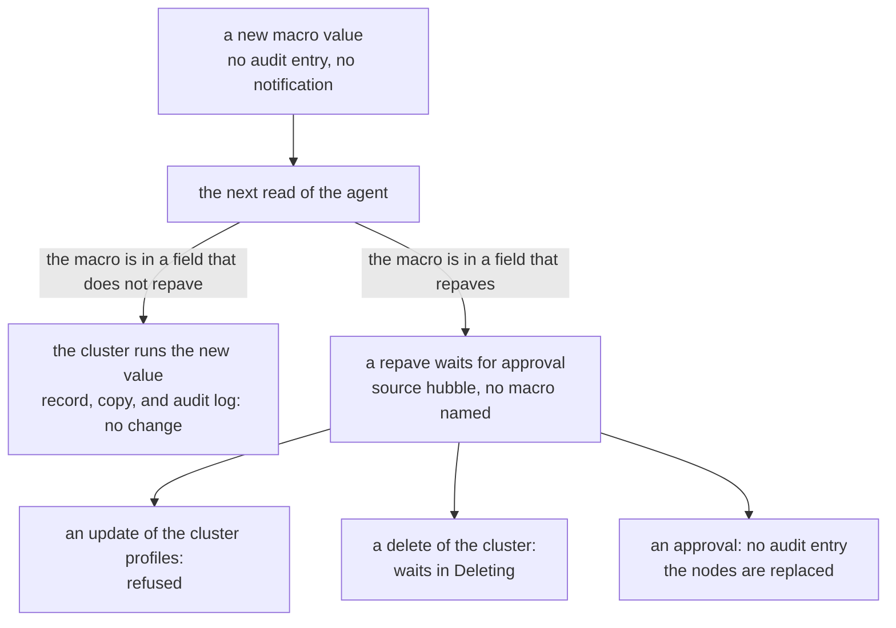

# Profiles

## Edits in place

A person can edit a published profile version through the API
([Update a cluster profile](https://docs.spectrocloud.com/profiles/cluster-profiles/modify-cluster-profiles/update-cluster-profile/)).
The version keeps its uid and its number, stays published, and no new version
appears. A pack can also be pushed again under one version, with
`spectro pack push --force`
([Spectro CLI reference](https://docs.spectrocloud.com/registries-and-packs/spectro-cli-reference/))
or `oras push`. A published profile that pins the version with the values of
the pack follows such a push at the next sync of the registry, with no request
from a person: see
[A pack version pushed again](packs.md#a-pack-version-pushed-again).

This is why [`strata verify`](../../commands/verify.md) exists. A record of a
version from before a person's edit, from before a push that the version followed, or from before a floating tag moved, exits
`1` with `DRIFT`, and names the change. A record of a cluster's copy from before
the cluster accepted an update does the same. `DRIFT` says that the object
changed. The audit log of Palette says who changed it, and when: see
[The audit log](#the-audit-log).

An edit through the API keeps the uid of each manifest. The live example sends
each uid back, and a cluster copy still names it.

The variables are the exception. Palette refuses a change of the variable
definitions of a version that a cluster uses: "you must create a new version of
your cluster profile before you can modify the variables"
([Modify cluster profile variables](https://docs.spectrocloud.com/profiles/cluster-profiles/create-cluster-profiles/define-profile-variables/modify-cluster-profile-variables/)).
The packs, the values, and the manifests have no such rule.

A reorder is an edit in place too. A `PUT` of a published version with the same
packs, values, and manifests in the other order is accepted, stored in the new
order, and audited as an update of the profile. Palette accepts it for the four
infrastructure layers of a version a cluster runs as well: the CSI layer first
and the OS layer last. `verify` on a record from before reports `DRIFT` and
`note: pack order changed between the two profiles`.

## Secrets in the values

The schema of a pack can give a value the format `password`. Palette writes
`********` over such a value when it serves the published packs of a profile
([Pack constraints](https://docs.spectrocloud.com/registries-and-packs/pack-constraints/)).
It does not write it over an empty value, or over a value that holds a
variable, `{{.spectro.var.NAME}}`. A record of a published version holds
`********`, and not the secret.

The export of a profile masks the values too. The code of Palette also masks the
copies of the profiles in the document of a cluster. No live run shows it: see
[What the source of Palette says](limits.md#what-the-source-of-palette-says).
So a profile record and a cluster record hold
the same mask. The root covers the mask and not the secret: two versions that
differ in a secret alone have one root. A record names each masked value in
`packs[].masked`, and `same-release`, `compare`, and `verify` name the pack. See
[A secret changes in a pack value](../../use-cases/masked-value.md).

Palette does not do this for the packs of a draft. A draft is the content of a
`PUT` with no publish. A profile that was never published has only a draft.
`GET /v1/clusterprofiles/{uid}` gives `spec.draft.packs` with each secret in
clear. When the profile has a draft,
`GET /v1/clusterprofiles/{uid}/packs/manifests` serves the packs of the draft.
These facts come from the code of Palette. No live run checks them: see
[What the source of Palette says](limits.md#what-the-source-of-palette-says).

So strata writes the mask itself. When a profile has a draft, strata reads the
schema of each pack of the draft with `GET /v1/packs/{uid}`. That answer gives
`packValues[].schema[]`, with the `name` of each value, such as
`charts.kube-prometheus-stack.grafana.adminPassword`, and its `format`, such as
`${password}`. Strata writes `********` over each value whose format is
`password`, with the rules of Palette, in the draft and in `packs/manifests`.
It does this before it makes the record, and before `--raw-dir` saves the
answers. The record of a profile with a draft only holds `********`, and not
the secret.

Strata changes only the line of each secret, so the rest of the values text
stays. When a value takes more than one line, strata writes the values again
from the parsed YAML, with no comments. The layout does not change the digest
of the values. A masked draft has the values digest of the same version that
Palette masks after the publish.

When Palette no longer has a pack, `GET /v1/packs/{uid}` answers HTTP 404.
Palette has no schema for the pack, so it masks nothing, and strata masks
nothing. Each other failure of that
read stops the record, so that strata never writes a secret that it could not
check.

## The export of a version

Palette writes a profile version as one file: the export
([Export and import](https://docs.spectrocloud.com/profiles/cluster-profiles/export-import-cluster-profile/)).
`GET /v1/clusterprofiles/{uid}/export?format=yaml` gives it in YAML, and
`format=json` in JSON. The file holds:

- `metadata`: `name`, `description`, and `labels`.
- `spec.version`.
- `spec.template`: `type`, `cloudType`, and `packs[]`. Each pack has `name`,
  `type`, `layer`, `version`, `tag`, `values`, `manifests[]` with `name` and
  `content`, and `registry.metadata`: `uid`, `name`, `kind`, `isPrivate`,
  `providerType`, and `isSyncSupported`.
- `spec.variables[]`: each variable, with an `order`.

Palette omits values that are empty, and a pack with no manifest has no
`manifests`. A manifest pack has a `registry.metadata` with an empty `uid` and
an empty `name`. The file has no pack uid, no digest, and no `params`.

Palette sends the file only to a request that accepts a file, such as
`Accept: application/octet-stream`. To a request with `Accept:
application/json`, it answers HTTP 200 with `{"Reader":{}}`. Palette can refuse
an export that follows another one at once. It answers HTTP 429, with the code
`TooManyRequests` and the message "only 1 request in 10 seconds is allowed". It
does not refuse each such export. Wait 10 seconds between two exports.

`snapshot --from-candidate` reads the file as a candidate: see
[A profile export of Palette](../../reference/candidate-file.md#a-profile-export-of-palette).
The record of the export of a version has the root of that version, in YAML
and in JSON. A version with a manifest pack differs only by the pack uid
that Palette mints, as for each candidate with a manifest layer.
[export.sh](../../development/live-runs.md#exportsh) shows each fact of this
section.

## The audit log

Palette logs each write to a profile, an app profile, a cluster, an edge host,
and a cluster group.
`GET /v1/audits?resourceKind=<kind>&resourceUid=<uid>&startTime=<time>` lists
the writes to one resource since a time, newest first, at most 100 on a page.
`listmeta.continue` names the next page, and is empty on the last one. Each
kind of object has its own kind in the log: `clusterprofile`, `appprofile`,
`spectrocluster`, `edgehost`, and `clustergroup`. A query with the uid of an
object and another kind finds no entry. Each entry gives the time, the action
(`create`, `update`, `delete`, `activity`, or `action`), the actor (a user,
with a name and a uid, or a Palette service, with a name), and `resource`: the
kind, the name, and the uid of the object. Some entries also give `contentMsg`,
a summary of the change, and `userMsg`, a note that a person adds with
`PATCH /v1/audits/{uid}/userMsg`. The API gives each entry a uid, and no
request id. [`verify --who`](../../commands/verify.md#who-changed-it) reads
this log. The log is also a page of the console, a CSV download, and a stream to
an external store
([Audit logs](https://docs.spectrocloud.com/audit-logs/),
[the API](https://docs.spectrocloud.com/api/v1/v-1-audits-list/)).

A virtual cluster has its create and its delete under the kind
`virtualCluster`. A query with `spectrocluster` and the uid of the virtual
cluster does not find them. A query with the uid alone, and no `resourceKind`,
finds the entries of each kind. The API reference gives 50 as the largest
`limit`, but Palette serves 100. A `limit` above 100 answers `500` with the
code `InvalidLimit`.

An edit in place through the API, a `PUT` of the version and then its publish,
is one entry: an `update` by the user who owns the key, with a summary that
names the manifest that changed.

The API does not return the content of the change. A summary names what
changed, such as the packs whose values changed, and not the values. The record
holds the content.

A floating tag that moves is logged too. When a profile pins a pack under
`1.0.x` and the registry gets `1.0.2`, the sync that reads it gives the profile
two entries: an `update` by the Palette service `system` with no summary, and
one whose summary names the pack and both versions, such as `version is updated
1.0.1 > 1.0.2`. No person is in either entry.

A published version that follows a push again of a pack gets one entry: an
`update` by the Palette service `system`, whose summary names the pack, its
version, and its layer, such as `strata-live-pack 1.0.0 layer is updated`.

A cluster that accepts an update through the API gives the cluster one entry:
an `update` by the user who sent the `PUT`, with a summary that names the uid
of the profile and the manifest that changed. The entry names who accepted the
update. The edit of the profile before it is an entry of the profile.

A version bump that overwrites the version that a cluster runs is a write to
the profile, and not to the cluster. The log of the cluster does not name it.

Each document of an object gives the time of its last change,
`metadata.lastModifiedTimestamp`. The time costs no request more than the
document. The pack listing gives the same field, but there it is the create
time of the pack: see
[What a registry answers about a pack](./packs.md#what-a-registry-answers-about-a-pack).

## Version bumps

A version bump behaves differently with the provider's
`immutable-clusterprofiles` flag:

| Result | Flag off | Flag on |
| --- | --- | --- |
| The uid | Keeps the uid, which names the new version. | The new version is a clone under a new uid. The old version stays under the old uid. |
| `verify` of the old record | Reports it overwritten by the new version. | Reports the edit in place, and nothing overwritten. |
| The clusters | Keep their copies, which name the old version, and stay consumers of the uid. | Keep their copies, which match what the old uid holds, and stay consumers of the old uid. |

The clone carries the content over exactly: the values, the manifests, and the
variables of a flag-on bump equal those of a flag-off bump from the same
configuration.

A version is a semantic version. The public documentation says that the
console writes a short form and a lowercase `v` prefix as the full version,
`1.2` as `1.2.0` and `v1.2.3` as `1.2.3`
([Version a cluster profile](https://docs.spectrocloud.com/profiles/cluster-profiles/modify-cluster-profiles/version-cluster-profile/)).
A version published through the API, as the provider does, keeps the string
that the request sent: `1.2` is listed as `1.2`, and `v1.2.3` as `v1.2.3`. So
two versions can name one number in two ways. A ref names the string that
Palette lists.

With the flag on, set `skip_destroy` on each profile **before** the first bump.
A flag-on bump replaces the profile resource, and the provider deletes the
replaced version with the `skip_destroy` value already in its state, not the new
value (provider 0.30.1). Without it, the bump asks Palette to delete the version that a cluster runs.

Each version in a state of its own is the other way to keep a version, with no
flag. A new version is a new resource with a uid of its own, and the state of
the version before it plans no change. A change of the content in the state of
an old version, at the same number, plans an update in place of the published
version. A destroy of that state asks Palette to delete the version, and
Palette refuses it while a cluster uses the version: the provider reports the
refusal, and the version stays. See
[A version bump overwrites a version](../../use-cases/overwritten.md#what-to-do).

## Drafts

A profile version has two templates: `spec.published` and `spec.draft`. An
edit of a published version through the API has two steps. The live example
does both:

1. `PUT /v1/clusterprofiles/{uid}` writes the packs, the values, and the
   manifests of the request to the draft. The published template stays.
2. `PATCH /v1/clusterprofiles/{uid}/publish` makes the draft the published
   template, and empties the draft. The version keeps its uid and its number.

Between the two steps, the draft waits. A person who edits a version in the
console, and a pipeline that updates and publishes in two steps, make a draft
that waits. A cluster runs the published template, and a new cluster gets the
published template too.

Palette serves the two templates as follows:

- The profile document gives both templates. Palette masks a secret only in
  the published template. Palette gives no `status.hasDraft`. A version has a
  draft when `spec.draft.packs` holds a pack.
- A create with no publish makes a version that nobody published. Its document
  gives the packs in `spec.draft`, no pack in `spec.published`, and
  `status.isPublished` false. A published version gives `status.isPublished`
  true, also while a draft waits. The profile listing names a version that
  nobody published, with the cloud type of its draft. The code of Palette gives
  these rules, and
  [draft.sh](../../development/live-runs.md#draftsh) checks them.
- A manifest is one object, with a published content and a draft content. The
  `PUT` writes the draft content of each manifest that it names by uid, and
  the published content stays. A manifest that the `PUT` adds has a draft
  content only.
- `GET /v1/clusterprofiles/{uid}/packs/manifests` lists the packs of the draft
  when there is a draft, with the values of the draft. For each manifest, it
  gives the published content. So while a draft waits, this answer holds the
  content of neither template. A manifest that the draft adds has an empty
  content in it. Each manifest of a version that was never published has an
  empty content in it too.
- `GET /v1/clusterprofiles/{uid}/packs/{packName}/manifests/{manifestUid}`
  gives one manifest with `spec.draft.content` and `spec.published.content`.
  A draft content is empty when the draft did not change the manifest.
- The publish writes the draft content of each changed manifest over its
  published content, and empties the draft content.

What strata does with this:

- A record of a version reads the published template. When the version has a
  draft, strata reads each manifest by its uid, and takes its published
  content. When the version was never published, the record reads the draft.
- `list --packs` reads the draft of a version that nobody published, and marks
  its row `draft`. See [strata list](../../commands/list.md#a-version-that-nobody-published).
- `<ref>@draft` records the draft: the values of the draft, and the draft
  content of each manifest that the draft changed. A version with no draft is
  the error `no-draft`. See [Refs](../../reference/refs.md).
- Strata reads the variables of the version from
  `GET /v1/clusterprofiles/{uid}/variables` for both templates.
- `verify` of a record of the draft compares it with the published version.
  After the publish, the record verifies:
  `OK: published version aws-stack@1.1.1 holds the draft recorded <time>`.

[`draft.sh`](../../development/live-runs.md#draftsh) checks these facts on the
live tenant. The use case is
[Review a draft before its publish](../../use-cases/draft.md).

## The lock of a cluster template

A cluster template links profile versions and a maintenance policy, and applies
them to the clusters attached to it
([Cluster templates](https://docs.spectrocloud.com/cluster-templates/)). The
public documentation says that a linked version is immutable. A live run shows
what the lock covers:

| Request | Answer |
| --- | --- |
| An edit in place of a version that a template links, through the API: a `PUT` of the whole version | Refused: `ClusterProfileUpdateValidationFailure`, "cluster profile is associated with 1 cluster templates (`<uid>`) and cannot be modified". The version verifies. |
| The same kind of edit through the route of one manifest: `PUT /v1/clusterprofiles/<uid>/packs/<pack>/manifests/<manifest uid>`, then the publish | Accepted. The linked version changes, and a record from before reports `DRIFT`. |
| A cluster outside the template, built with a linked version | Refused: `ClusterCreateWithTemplateProfileForbidden`, "Cluster creation is not allowed as profile ... is already attached to one or more cluster templates". |
| The same edit, after the template is removed | Accepted. A record from before reports `DRIFT`. |

So the lock belongs to the template, and it covers the route of the whole
version: the `PUT` of the whole version checks it. In the code of Palette,
the routes of one pack and of one manifest do not check it, and the live run
changes a linked version through the route of one manifest. `verify` finds an
edit through such a route. The lock holds against a new cluster: it keeps every
cluster outside the template away from a linked version. A cluster that runs a
linked version is a cluster the template applies.

The template also takes the repave question of its clusters. These facts come
from the code of Palette, not from a live run:

- The cluster document names the template in `spec.clusterTemplate`, with
  `uid` and `projectUid`.
- `POST /v1/spectroclusters/<uid>/validate/repave` compares nothing for such a
  cluster. The answer is `200` with `isRepaveRequired: false` and no reason:
  the same answer as a change that does not repave.
- `POST /v1/spectroclusters/clusterTemplates/<uid>/validate/repave` answers
  for the template. The body is `profiles[]`, each with a `uid` only, and
  `isUpgradeNow`. Palette asks the question of one cluster of the template,
  with the profiles of the body as the target. A profile that the cluster runs
  keeps its copy, and a new uid takes its published packs.
- Palette takes that cluster from a map, in no fixed order. So two requests
  can ask two different clusters of the template, and the cluster that
  `compare` names can be a different one.
- With `isUpgradeNow: true`, Palette uses the profiles of the template, not
  the profiles of the body. It asks one cluster that waits for the update of
  the template, or that failed it.
- A template with no cluster gets `isRepaveRequired: false` and no reason.

`compare --repave` sends the route of the template for such a cluster: see
[A cluster in a cluster template](../../commands/compare/repave.md#a-cluster-in-a-cluster-template).

## What the create of a version checks

Palette refuses a profile version at the create when it breaks a rule. Some
rules are on the values and the packs. These are the YAML of the values and the
manifests, the limit of 200 packs and 200 manifests, a disabled pack, and the
dependencies of each pack. `POST /v1/clusterprofiles/validate/packs` checks
these rules and writes nothing:
see [The validate routes](./validate-routes.md#post-v1clusterprofilesvalidatepacks).

The create also checks rules that the validate route does not check. These
rules come from the code of Palette, not from a live run. No route that takes
a candidate answers them before the create, so strata fills each gap: see
[The gaps that strata fills](#the-gaps-that-strata-fills).

Strata also keeps the rules that the root needs. At the create, Palette
changes some content with no error. A candidate with that content gives a root
that the published version does not have. A
[manifest layer](../../reference/candidate-file.md#a-manifest-layer) takes the
layer `addon`. A pack from a registry takes
[the layer of the registry](./packs.md#the-layer-of-a-pack). A
[pack from a registry that Palette does not sync](../../reference/candidate-file.md#a-layer-from-a-registry-that-palette-does-not-sync)
gets the pack that Palette makes.

## The gaps that strata fills

Palette checks these rules only at the create of a profile version. No route
that takes a candidate checks them, so a team learns of a fault only at the
create. Strata checks each rule before any request. The refusal is
`candidate-invalid`, with the code that Palette gives at the create:

| Rule | Code |
| --- | --- |
| The version parses as semver: an optional `v`, one to three numbers, an optional pre-release after `-`, and optional build data after `+`. Each number fits in a 64-bit integer. So `1.1` and `v1.2.3` pass, and `2.2.2.develop` and `1.2.3.4` do not. | `VersionParseFailure` |
| Each pack name is in the profile once. Palette compares the names as they are. | `DuplicatePacksForbidden` |
| The name of each manifest, and of each manifest pack, is a DNS-1123 label of 32 characters at most. It holds lowercase letters, digits, and `-`, and it starts and ends with a letter or a digit. | `InvalidName` |
| Each manifest name is in its pack once. | `DuplicatePackManifestsForbidden` |
| The type of the profile takes the layer of each pack. An `infra` profile takes `os`, `k8s`, `cni`, and `csi`. A `cluster` profile takes each layer. Each other type takes `addon`, `cni`, and `csi`. | `ClusterProfilePackNotAllowed` |
| A `cluster` or `infra` profile has an `os`, a `k8s`, a `cni`, and a `csi` layer. On the cloud `edge-native`, it needs no `csi` layer. | `ErrPackCoreLayersMissing` |
| Each pack supports the cloud of the profile. This is true when the cloud is `all`, or when the pack has no cloud type. It is also true when the cloud types of the pack hold the cloud, `all`, or `custom` for a cloud that Palette does not know. | `PackNotSupported` |
| The tag of a pack that Palette makes for a registry that it does not sync is a semantic version, or holds three numbers with dots between them. | `InvalidPackVersion` |

The layer of a pack comes from the pack in its registry, and not from the
profile: see [The layer of a pack](./packs.md#the-layer-of-a-pack). So the
rules of the type and of the core layers use the layer that the registry
gives. Strata checks them again after it reads the registry. The pack that
Palette makes for a registry that it does not sync has the layer `addon` and no
cloud type.

Palette is the owner of each rule. When a route of Palette answers a rule
before the create, strata removes its check and asks that route. The review at
the end of each wave reads this list.

Strata does not copy the rules that the validate route checks: see
[Checks before any request](../../reference/candidate-file.md#checks-before-any-request).

## What the delete of a version checks

Palette refuses the delete of a profile version while one of these uses it, in
any project, also a project that the key cannot read:

- a cluster that runs the version
- a cluster template that links the version and is not deleted
- an edge host that the version is bound to

The refusal has the code `DeletionResourceInUseError`, and names the kind of the
first consumer that it finds, in the order of the list above. A template blocks
the delete also when no cluster runs the version. The refusal is HTTP `500`, and
its message names the consumer, for example `Unable to delete the resource as
strata-live-template clustertemplate(s) in-use`.

`GET /v1/clusterprofiles/<uid>` names the clusters in `status.inUseClusters`
and `status.inUseClusterUids`, and the templates in
`status.inUseClusterTemplates`, each with `uid`, `name`, `projectUid`, and
`kind: clustertemplate`. Palette computes the three lists when it is asked, with
the query of the delete check. When one query fails, all three lists are empty.
The profile document names no edge host.

So [`strata consumers`](../../commands/consumers.md) counts the clusters and the
templates of the profile document, and searches the edge hosts.

## The variables route

`GET /v1/clusterprofiles/<uid>/variables` gives `{"variables":[]}` for a version
that declares no variables. When Palette does not have the version, the route
answers HTTP `404` with the code `ResourceNotFound`, as the profile document
does.

An older Palette with no variables route also answers 404. So after a 404 of
the variables route, strata reads the profile document again. When that read
answers HTTP 404, the version is gone: the record fails, and `verify` reports
the version as gone. Another error of that read stops the record. When strata
can read the profile, it records no variables and sets `variablesUnavailable`.
[`verify.sh`](../../development/live-example.md#the-checks-of-verifysh) checks
these answers on the live tenant.

## A variable in a field that repaves

A profile version can read a profile variable in a field that repaves a
cluster. When the cluster does not run that version, it holds no value for the
variable. A live run asks `POST /v1/spectroclusters/<uid>/validate/repave`
about such a move:

- Cluster A runs the release version 1.0.0. Its Kubernetes pack has the kubeadm
  command `chmod 600 /var/lib/kubelet/config.yaml`.
- Version 1.0.1 declares the variable `strata_mode`, with the default `600`.
  Its command is
  `chmod {{.spectro.var.strata_mode}} /var/lib/kubelet/config.yaml`. Its CSI
  pack also has another `reclaimPolicy`, which does not repave.

| The body of the request | The answer of Palette |
| --- | --- |
| The uid of 1.0.1 in place of 1.0.0, and the uid of the add-on profile of the cluster, with no `packValues` and no `variables[]`. `compare --repave` sends this body. | No repave. |
| One profile: the uid of 1.0.0, `replaceWithProfile` 1.0.1, and the `packValues` of 1.0.1, with no `variables[]`. `tenant.sh repave` sends this body. | Repave: `PackValuesUpdated`, `kubernetes`, `kubeadmconfig.postKubeadmCommands`. |
| The same, with `strata_mode` `600`, the default | The same repave. |
| The same, with `strata_mode` `644` | The same repave. |

So the value that the body gives a variable does not change the answer. With
the `packValues` of 1.0.1, Palette says repave also for the value that gives
the command the cluster runs. A body with `variables[]` gets the same answer as
a body without it, so `compare --repave` sends no `variables[]`.

The two forms of the body give two answers for one move. No run applies such a
version to a cluster, so no run shows which answer the nodes follow. Stage 8 of
[repave.sh](../../development/live-runs.md#repavesh) gives the answers:
`examples/live/repave.sh 8`.

## Macros

A macro is a name and a value, with no version, no history, and no digest
([Macros](https://docs.spectrocloud.com/clusters/cluster-management/macros/)).
`GET /v1/projects/<uid>/macros` lists the macros of a project; `POST` adds one,
`PATCH` changes one, `PUT` replaces the whole set, and `DELETE` removes one.

A profile whose manifest reads a user macro, `{{.spectro.macro.<name>}}`, has
`status.hasUserMacros: true`. A profile that reads none has `false`.

`GET /v1/spectroclusters/<uid>/packs/resolvedValues` gives, for each profile a
cluster runs, a map from each placeholder to the value Palette gives it now.
The map holds every macro Palette can resolve for the profile, the system ones
too, such as the cluster name and the region, and not only the ones the profile
reads. It gives a new macro value at once.

`GET /v1/clusterprofiles/<uid>/packs/resolvedValues` resolves the macros of a
profile version with no cluster. It gives one `resolved` map, and not one map
for each profile. The map holds the user macros of the scope of the version
and the system macros. A system macro of a cluster, such as
`{{.spectro.system.cluster.name}}`, has an empty value there.
`GET /v1/clustergroups/<uid>/packs/resolvedValues` answers HTTP 404
`ResourceNotFound` for a group that Palette does not have. The message starts
with `Cluster Group '<uid>' is not found`.

When a macro gets another value:

- The profile and its record do not change: `verify` of the record reports `OK`.
- The copy that a cluster holds does not change: `verify` of a cluster record
  without the digests of its macro values reports `OK`.
- No notification opens for the cluster, and the audit log of the cluster
  holds no entry for it.

The cluster still gets the new value. Palette writes it into the running
cluster on its own, with no update to accept: a live run read it inside the
cluster 11 minutes after the change, and a run before it 13 minutes after. So a
cluster runs the new value, and its record, its copy, its notifications, and
its audit log stay as they were. The digests of `snapshot --macros` show it:
see [Macros](../../commands/snapshot/cluster.md#macros).

A create, a change, or a delete of a project macro writes no audit entry, at
project or tenant scope. No audit entry names a macro.

The two paths of a new macro value, from the change to what it holds:

When a macro is in a field that repaves a cluster, such as
`kubeadmconfig.postKubeadmCommands` in the Kubernetes pack, a change of its
value does not replace the nodes. At the next read of the agent, Palette puts
the cluster in a repave that waits for approval (`status.repave.state:
Pending`), one agent poll after the change. It opens no notification for it.
`GET /v1/spectroclusters/<uid>/repave/status` gives the record: the source is
`hubble`, and not a person. The one reason is `PackValuesUpdated`, `Pack
'kubernetes' values are updated`, with the key that differs and the resolved
values on each side. It names no macro, so nothing in the record says that a
macro caused it. While the repave waits, Palette
refuses an update of the cluster profiles: `Cluster update failure as cluster
repave is pending for approval`. Palette also refuses to delete a macro that a
cluster reads.

A repave that waits for approval also holds a delete of the cluster. The delete
puts the cluster in `Deleting`, and the agent removes nothing while the repave
waits: in a live run, the cluster stayed in `Deleting` for 37 minutes, its EC2
instances kept running, and `tofu destroy` failed with `context deadline
exceeded`. After an approval of the repave, the instances were gone in four
minutes. The approval writes no audit entry.

A cluster record holds the repave that waits, with the reasons of Palette, and
`compare` and `verify` name it.
[macro-repave.sh](../../development/live-runs.md#macro-repavesh) shows it on
cluster A. See
[Whether a repave waits](../../commands/snapshot/cluster.md#whether-a-repave-waits).
