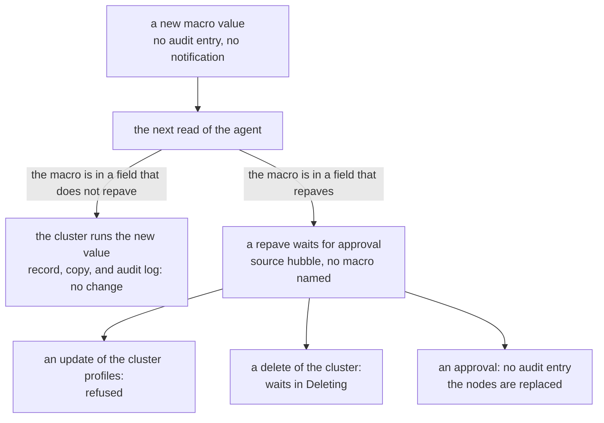

# Profiles

## Edits in place

A person can edit a published profile version through the API
([Update a cluster profile](https://docs.spectrocloud.com/profiles/cluster-profiles/modify-cluster-profiles/update-cluster-profile/)).
The version keeps its uid and its number, stays published, and no new version
appears. A pack can also be pushed again under one version, with
`spectro pack push --force`
([Spectro CLI reference](https://docs.spectrocloud.com/registries-and-packs/spectro-cli-reference/))
or `oras push`. A published profile that pins the version keeps the digest it
was pinned with, in an OCI registry: see
[A pack version pushed again](packs.md#a-pack-version-pushed-again). A Spectro pack
registry is not covered: see [What no run covers](limits.md#what-no-run-covers).

This is why [`strata verify`](../../commands/verify.md) exists. A record of a
version from before a person's edit, or from before a floating tag moved, exits
`1` with `DRIFT`, and names the change. A record of a cluster's copy from before
the cluster accepted an update does the same. `DRIFT` says that the object
changed. The audit log of Palette says who changed it, and when: see
[The audit log](#the-audit-log).

An edit through the API keeps the uid of each manifest. The live example sends
each uid back, and a cluster copy still names it.

A reorder is an edit in place too. A `PUT` of a published version with the same
packs, values, and manifests in the other order is accepted, stored in the new
order, and audited as an update of the profile. Palette accepts it for the four
infrastructure layers of a version a cluster runs as well: the CSI layer first
and the OS layer last. `verify` on a record from before reports `DRIFT` and
`note: pack order changed between the two profiles`.

## The audit log

Palette logs each write to a profile and to a cluster.
`GET /v1/audits?resourceKind=<kind>&resourceUid=<uid>&startTime=<time>` lists
the writes to one resource since a time, newest first, at most 100 on a page.
`listmeta.continue` names the next page, and is empty on the last one. The kind
is `clusterprofile` or `spectrocluster`. Each entry gives the time, the action
(`create`, `update`, `delete`, `activity`, or `action`), and the actor: a user,
with a name and a uid, or a Palette service, with a name. Some entries also
give `contentMsg`, a summary of the change. An entry has a uid, and no request
id. [`verify --who`](../../commands/verify.md#who-changed-it) reads this log.

An edit in place through the API, a `PUT` of the version and then its publish,
is one entry: an `update` by the user who owns the key, with a summary that
names the manifest that changed.

The log does not hold the content of the change. The record holds it.

A floating tag that moves is logged too. When a profile pins a pack under
`1.0.x` and the registry gets `1.0.2`, the sync that reads it gives the profile
two entries: an `update` by the Palette service `system` with no summary, and
one whose summary names the pack and both versions, such as `version is updated
1.0.1 > 1.0.2`. No person is in either entry.

A cluster that accepts an update through the API gives the cluster one entry:
an `update` by the user who sent the `PUT`, with a summary that names the uid
of the profile and the manifest that changed. The entry names who accepted the
update. The edit of the profile before it is an entry of the profile.

## Version bumps

A version bump behaves differently with the provider's
`immutable-clusterprofiles` flag:

| Result | Flag off | Flag on |
| --- | --- | --- |
| The uid | Keeps the uid, which names the new version. | The new version is a clone under a new uid. The old version stays under the old uid. |
| `verify` of the old record | Reports it overwritten by the new version. | Reports the edit in place, and nothing overwritten. |
| The clusters | Keep their copies, which name the old version, and stay consumers of the uid. | Keep their copies, which match what the old uid holds, and stay consumers of the old uid. |

The clone carries the content over exactly: the values, the manifests, and the
variables of a flag-on bump equal those of a flag-off bump from the same
configuration.

A version is a semantic version. Palette normalizes a short form and a lowercase
`v` prefix, `1.2` to `1.2.0` and `v1.2.3` to `1.2.3`, and refuses a malformed
string. Palette checks the version when it is created and when it is changed,
and the provider does not
([Version a cluster profile](https://docs.spectrocloud.com/profiles/cluster-profiles/modify-cluster-profiles/version-cluster-profile/)).

With the flag on, set `skip_destroy` on each profile **before** the first bump.
A flag-on bump replaces the profile resource, and the provider deletes the
replaced version with the `skip_destroy` value already in its state, not the new
value (provider 0.30.1, `resourceClusterProfileDelete`). Without it, the bump asks Palette to delete the version that a cluster runs.

## The lock of a cluster template

A cluster template links profile versions and a maintenance policy, and applies
them to the clusters attached to it
([Cluster templates](https://docs.spectrocloud.com/cluster-templates/)). The
documentation says that a linked version becomes immutable. A live run shows
what that lock is:

| Request | Answer |
| --- | --- |
| An edit in place of a version that a template links, through the API | Refused: `ClusterProfileUpdateValidationFailure`, "cluster profile is associated with 1 cluster templates (`<uid>`) and cannot be modified". The version verifies. |
| A cluster outside the template, built with a linked version | Refused: `ClusterCreateWithTemplateProfileForbidden`, "Cluster creation is not allowed as profile ... is already attached to one or more cluster templates". |
| The same edit, after the template is removed | Accepted. A record from before reports `DRIFT`. |

So the lock belongs to the template, not to the version. It holds while the
template links the version, and it keeps every cluster outside the template
away from that version. A cluster that runs a linked version is a cluster the
template applies.

## Macros

A macro is a name and a value, with no version, no history, and no digest
([Macros](https://docs.spectrocloud.com/clusters/cluster-management/macros/)).
`GET /v1/projects/<uid>/macros` lists the macros of a project; `POST` adds one,
`PATCH` changes one, and `DELETE` removes one.

A profile whose manifest reads a user macro, `{{.spectro.macro.<name>}}`, has
`status.hasUserMacros: true`. A profile that reads none has `false`.

`GET /v1/spectroclusters/<uid>/packs/resolvedValues` gives, for each profile a
cluster runs, a map from each placeholder to the value Palette gives it now.
The map holds every macro Palette can resolve for the profile, the system ones
too, such as the cluster name and the region, and not only the ones the profile
reads. It gives a new macro value at once.

When a macro gets another value:

- The profile and its record do not change: `verify` of the record reports `OK`.
- The copy that a cluster holds does not change: `verify` of a cluster record
  without the digests of its macro values reports `OK`.
- No notification opens for the cluster, and the audit log of the cluster
  holds no entry for it.

The cluster still gets the new value. Palette writes it into the running
cluster on its own, with no update to accept: a live run read it inside the
cluster 11 minutes after the change, and a run before it 13 minutes after. So a
cluster runs other content, and its record, its copy, its notifications, and
its audit log say nothing. The digests of `snapshot --macros` are how strata
sees it: see [Macros](../../commands/snapshot.md#macros).

A create, a change, or a delete of a project macro writes no audit entry, at
project or tenant scope. The audit log has no resource kind for a macro.

The two paths of a new macro value, from the change to what it holds:

When a macro is in a field that repaves a cluster, such as
`kubeadmconfig.postKubeadmCommands` in the Kubernetes pack, a change of its
value does not replace the nodes. At the next read of the agent, Palette puts
the cluster in a repave that waits for approval (`status.repave.state:
Pending`), one agent poll after the change. It opens no notification for it.
`GET /v1/spectroclusters/<uid>/repave/status` gives the record: the source is
`hubble`, and not a person. The one reason is `PackValuesUpdated`, `Pack
'kubernetes' values are updated`, with the key that differs and the resolved
values on each side. It names no macro, so nothing in the record says that a
macro caused it. While the repave waits, Palette
refuses an update of the cluster profiles: `Cluster update failure as cluster
repave is pending for approval`. Palette also refuses to delete a macro that a
cluster reads.

A repave that waits for approval also holds a delete of the cluster. The delete
puts the cluster in `Deleting`, and the agent removes nothing while the repave
waits: in a live run, the cluster stayed in `Deleting` for 37 minutes, its EC2
instances kept running, and `tofu destroy` failed with `context deadline
exceeded`. After an approval of the repave, the instances were gone in four
minutes. The approval writes no audit entry.
