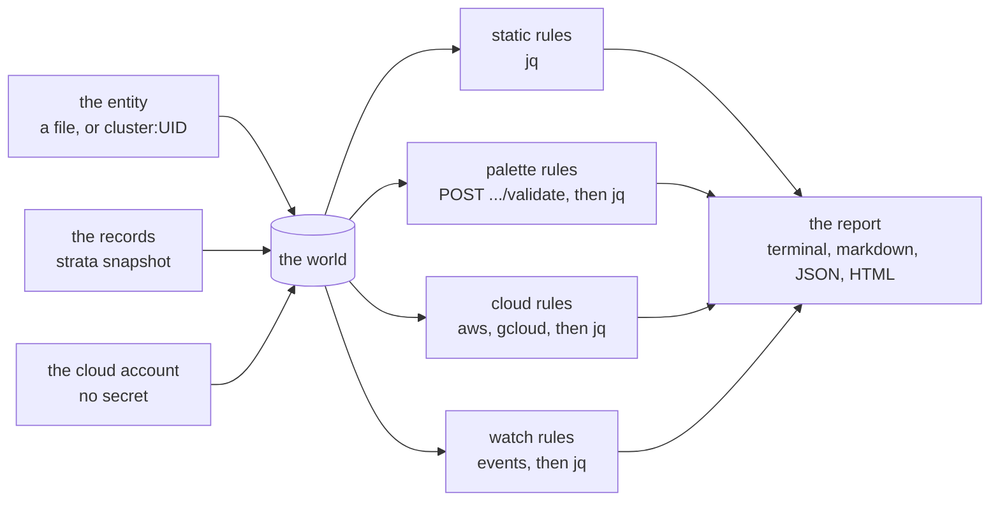

# How preflight works

`strata preflight` answers one question before a cluster build: can Palette
build this cluster? This page states the model behind the answer: the tiers,
the two levels, the confidence of a rule, the promotion of a probe, and the
decisions that shaped the tool.

## One document, many programs

A run builds one JSON document, the world: the engine, the release, the entity
of the create, the entity before a change, a record of each profile, the pack
of each layer, and the cloud account with no secret. Each rule is a jq program
over that document. A check that asks Palette or runs a tool adds its answer to
a copy of the document and then runs its program.

One document and one language mean one thing for a person to learn. A rule reads
as the `jq` line that shows the same fault by hand, and the report prints that
line. Strata ships the programs as data, so a company writes its own probes in
the same form, and a pipeline reads the list with `--rules --json`.

## The tiers

Each rule has a tier: where a check can find the fault.

| Tier | Runs where | Cost |
| --- | --- | --- |
| static | the entity and the records alone | milliseconds, no key |
| palette | one request to Palette | seconds, a key |
| cloud | one command with the tool of the cloud | seconds, the tool and its credentials |
| watch | the conditions and the events of the cluster during the build | minutes, until the first stuck state |
| race | no check before the build finds it; the watch finds its effect | — |
| tool | a rule of the tool that makes the entity | out of scope |

Strata calls no cloud API itself. A cloud rule runs `aws` or `gcloud` when the
tool is on the machine, so the credentials stay where the person keeps them.
When the tool is not there, the rule is `NOT CHECKED`, with the command to run
by hand: the gap is named, never hidden.

## Two levels: probe and preflight check

Each rule has a level. The level says how much a person can trust the result.

- **Probe.** Strata knows the fault, and not yet all of how to find it, or the
  runs do not yet prove the check. The source or the documentation shows the
  fault, or a live run showed it once. A probe reports `PROBE PASS` or
  `PROBE FAIL` with its evidence, and does not change the exit code. `--strict`
  counts a failed probe as a failed check.
- **Preflight check.** Strata knows what to look for, where, and how, and the
  runs prove it. A failed preflight check makes the exit code `1`.

Each rule starts as a probe. A probe becomes a preflight check when each of
these is true:

1. A live run shows the fault.
2. The check is code, with a fixture that makes the fault and fails, and a
   fixture of a clean entity that passes.
3. The runs prove it, per engine that the rule names and per Palette release.
   A static rule is deterministic, so a run again adds nothing: one run that
   made the fault, and one clean run. A live or watch rule meets the bar of
   [Confidence](#confidence): the 95% lower bound of its catch rate and of its
   clean-pass rate is 80% or more.
4. The rule names the runs of its promotion as its evidence.

A preflight check that gives one wrong result, a failure of a clean build or a
miss of a fault, goes back to a probe, and the run is its evidence. A new
Palette release that changes the behavior does the same.

`strata preflight --promotion` compares the level of each rule with the ledger
and says `promote` or `demote`. It reads the first rule too: a rule whose
status is `source` or `inferred` stays a probe whatever the runs of the plan
count, because the plan makes the fault in the entity and does not build; a
build that shows the fault makes the rule `seen`. A level that disagrees with the ledger is exit
`1`, so a rule cannot claim a level that the runs do not give. The level is a
field of the rule, changed by a person, with the run ids beside it.

## Confidence

A percentage of confidence is a count of runs, never an estimate. For each
rule, per engine and Palette release, the ledger holds the runs that made the
fault on purpose and the runs of a clean build, and what the check answered.

- **Catch rate:** of the runs that made the fault, the runs in which the check
  found it.
- **Clean-pass rate:** of the runs of a clean build, the runs in which the check
  passed.

Each rate shows its counts and the 95% lower bound of the rate (Clopper-Pearson,
one side), never the rate alone. With no wrong result in n runs, the bound is
0.05^(1/n):

| Correct runs | 95% lower bound |
| --- | --- |
| 3 of 3 | 37% |
| 5 of 5 | 55% |
| 10 of 10 | 74% |
| 14 of 14 | 81% |
| 20 of 20 | 86% |
| 30 of 30 | 90% |

One miss costs many runs: 13 of 14 is 70%, and 19 of 20 is 78%, both under the
bar. A rule with no runs shows `no runs`, and no percentage. A new Palette
release sets the counts of a rule to zero for that release; `4.10.3` and `4.10`
are one release. The runs are of the lab: one account, one region, one set of
packs. They are not a sample of another estate. The bar is `0.8`, as a field of
each rule, so that it can go up.

## The section scorecard

Each section of the catalog has one line of counts. It has no blended
percentage: a pool of the runs of different rules hides a bad rule. The
accuracy of a section is the lowest bound of its rules.

| Column | What it counts |
| --- | --- |
| rows | the rows of the section that apply to the engine |
| seen | the rows that a live run shows |
| with a check | the rows with a check in code |
| preflight | the rows promoted to preflight checks |
| weakest bound | the lowest 95% lower bound of a promoted rule, or `no runs` |
| ran, passed, failed, not checked | the checks of this run |
| readiness | `passed / ran`, or none when nothing ran |

No number measures what the catalog does not hold. A low count of `seen` is the
sign of gaps: networking has the most rows and the least evidence, so the lab
runs go there first.

## Readiness, and the 80% gate

Readiness is the share of the checks that ran and passed, over the rules of
severity `fail` and `warn`; a note is outside it. It is a view for a person and
a gate for a job: `--ready 80` is exit `1` under 80%. It says how ready an
estate is to start a first build, and where the work is first. It does not say
that a build will pass: a row that is `NOT CHECKED` is outside the count, and
the report prints that count beside the readiness so nobody reads 100% of three
checks as ready.

## The decisions

| # | Decision | Instead of | Consequence |
| --- | --- | --- | --- |
| P1 | Rules are data in YAML, with the check as a jq program. | Each check as Rust code. | A person reads a rule as the `jq` line that shows the fault by hand; the report prints that line. A company writes its own probes in the same form. A new rule needs no release of strata. |
| P2 | One world document for every kind of check. | A shape for each kind. | One thing to learn, one fixture format, one `--out world.json` to reproduce from. |
| P3 | A 4xx of Palette is an answer, not an error. | Every non-2xx as `ERROR`. | The validate routes refuse a wrong entity with a 400 and a code: that is the result. A 5xx or a transport error stays `ERROR`, exit `2`. |
| P4 | Strata runs the tool of the cloud, and calls no cloud API. | A cloud SDK in strata. | No credential passes through strata. The command in the report is the command a person runs. A tool that is not there is `NOT CHECKED`, named. |
| P5 | Two levels, and a failed probe does not change the exit code. | One level. | A young rule cannot stop a build by itself. `--strict` is the opt-in. |
| P6 | Confidence is a count of runs with a one-sided lower bound, per engine and release. | A percentage a person estimates. | The bound falls fast with one miss, so a promoted rule is one that the runs earned. A level that the ledger does not support fails `--promotion`. |
| P7 | The level is a field of the rule, and a check keeps it honest. | The level derived from the ledger at run time. | A person promotes with the run ids beside it, and the check refuses a level the runs do not give; a company promotes its own probes on its own runs. |
| P8 | `strata-preflight` is a package of its own, and `strata preflight` runs its binary. | A module of the strata crate. | The strata crate stays free of the jq engine. Another repository depends on the package by its git address. A release ships both binaries in one directory. |
| P9 | The catalog keeps every row of #91, with a check or without. | Rules for the checks that run. | A row with no check is `NOT CHECKED` with its reproduce lines: the gap is in the report, not in a comment. |
| P10 | The `cluster:UID` form turns the cluster into the body of a create. | Rules that read the cluster document. | One shape for a file and a cluster; a change file merges over it, pool by pool. |
