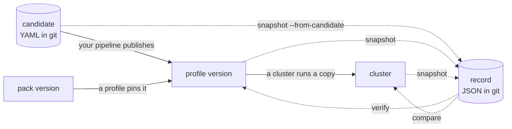

# strata

Strata records, compares, and checks what Spectro Cloud Palette holds: a
cluster profile version, the copy that a cluster runs, and a pack version in a
registry. A published profile version is what Palette builds a cluster from.
Strata calls it a release.

A cluster profile is a stack of layers: OS, Kubernetes, CNI, CSI, and add-ons.
An add-on profile is a profile of add-on layers alone, which a cluster runs
beside its cluster profile; a cluster can run several of them.
Each layer is a pack with a version, a digest, and values. Palette lets a
person edit a published version in place. Two projects can hold one version
name with different contents. Strata calculates one digest for each version,
the **root**. Two versions with the same root are the same release.



A solid arrow is somebody else. A profile version pins a pack version, a
cluster runs a copy of a profile version, and your pipeline publishes the
version. Strata publishes nothing.

A dotted arrow is strata, which reads and writes files. Both files it knows are
in your repository: a **candidate**, the version as YAML before Palette has it,
and a **record**, the hashes of a version that Palette holds. `snapshot` writes
a record from any of the three. `verify` asks whether Palette still holds what a
record says. `compare` reports what differs between two of them.

The root closes the loop. A candidate and the published version give the same
root, so `same-release` proves that Palette holds the version that a reviewer
approved, without trusting a tag or a name.

| Question | Command |
| --- | --- |
| What changed between two versions? | [`strata compare A B`](./commands/compare.md) |
| Does Palette still have the version that I recorded? | [`strata verify record.json`](./commands/verify.md) |
| Do dev and prod have the same release? | [`strata same-release dev.json prod.json`](./commands/same-release.md) |
| Does this cluster run its release? | [`strata compare record.json cluster:NAME`](./use-cases/cluster-release.md) |
| What changed between two pack versions? | [`strata compare pack:NAME@A pack:NAME@B`](./use-cases/pack-versions.md) |
| Can I delete this version? | [`strata consumers NAME@VERSION`](./commands/consumers.md) |

## Where to start

1. [Install](./install.md) strata.
2. [Configure](./configure.md) the API key and the project.
3. Do the [quick start](./quickstart.md).
4. Find your problem in [Use cases](./use-cases/index.md).

## The profile that the pages use

Most pages use one profile, `aws-stack`, with the versions 1.0.0, 1.1.0 and
1.1.1, and the clusters `payments`, `search` and `ledger`. A page that needs a
second profile adds the add-on profile `platform-addons`. A page that needs
another version adds one, such as 1.1.3 or 1.2.0. The pack pages read a pack
from a registry and use no profile. None of it is a profile of your tenant.
Strata builds it from the pack data that this repository tracks:

```bash
just examples
```

This needs no key and no network, and it costs nothing. It writes the records
to `examples/profiles/`, so a page that reads a ref by name reads a file here:
`aws-stack@1.1.1` becomes `examples/profiles/aws-stack@1.1.1.json`.

```bash
strata compare examples/profiles/aws-stack@1.0.0.json examples/profiles/aws-stack@1.1.0.json
```

To run the commands of a page, with the names and the clusters it prints, serve
the same tenant on this machine:

```bash
just playground
```

It prints the settings to export. A stand-in for the Palette API then answers
`strata list`, `strata compare aws-stack@1.0.0 aws-stack@1.1.0`,
`cluster:payments`, and the rest, with no key and no cost. `just playground
<chapter>` serves the tenant of another chapter of this book.

Strata writes its report to standard output, and its progress to standard
error. A block in this book that starts with a `strata:` line shows both. A
block that shows the report alone has the progress dropped, or the command
carries `--quiet`. A page that describes a change to the tenant of its chapter
gets the tenant as its first steps see it, and the page says what changes
after that.

With your own tenant, the same pages read your profile names.
[The offline examples](./development/examples.md) tells what `just examples`
builds.

## The rule

A release does not change after you publish it. It keeps its name, its version,
and its content. To change a release, publish a new version. `strata verify`
tells you when a person or a tool breaks this rule.

Strata reads Palette and writes files. It publishes nothing. It works in the
same way when a team publishes with Terraform, the API, or the Palette console.
It has no opinion about where the records live, which registry holds the packs,
which cloud the profile targets, or which CI system runs the commands.
