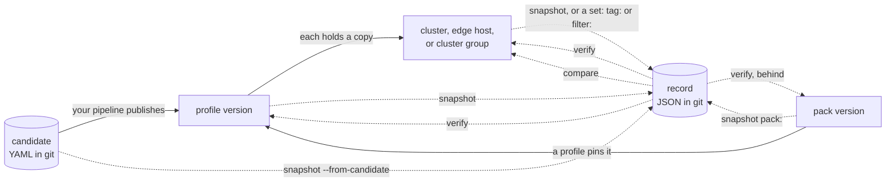

# strata

Spectro Cloud Palette lets a person edit a published profile version in place,
and it keeps no digest of what a version holds. So the name of a release does
not say what a cluster runs, and nothing tells you when the content under the
name changes.

Strata gives each version one digest, the **root**. It keeps the root, and the
content behind it, in a **record** in your repository. Then it checks Palette
against the record at each step of the life of a release: in the pull request,
at the merge, at the publish, each night, and before a version is deleted.

A cluster build in Palette fails late, and often with no message. Before a
build, `strata preflight` runs a catalog of rules against the body of the
create and reports what will stop the build, in seconds, with the command that
shows the same thing by hand. See
[Stop a build that Palette cannot finish](./use-cases/stop-a-build.md).

- [The everyday loop](./loop.md) shows who runs what, and when, with one change
  from the pull request to the retire.
- [Where each part belongs](./boundary.md) says what Palette does already, what
  strata adds, and why the check stays outside Palette.

## The model

A published profile version is what Palette builds a cluster from. Strata calls
it a release.

A cluster profile is a set of layers, kept in the order given. The layers come
from the environment: on AWS they are an OS, Kubernetes, a CNI, a CSI, and
add-ons, and other environments use fewer. An add-on profile is a profile of
add-on layers alone, which a cluster runs beside its cluster profile; a cluster
can run several of them. Each layer is a pack with a version, values, and the
digest that Palette lists for it. Two versions with the same root are the same
release, whatever their names, their uids, or the project that holds them.

A cluster runs its own copy of each version that it applies. An edge host and a
cluster group hold their own copies too, and an app profile is a version with
no publish step. Strata records each of them, and each pack version in a
registry.



A solid arrow is somebody else. A profile version pins a pack version, each
cluster, edge host, and cluster group holds a copy of a profile version, and
your pipeline publishes the version. Strata publishes nothing.

A dotted arrow is strata, which reads and writes files. It knows two files, and
where you keep them is your choice: a **candidate**, the version as YAML before
Palette has it, and a **record**, the hashes of an object that Palette holds.
`snapshot` writes a record of any of them, and one record for each cluster of a
label or a saved tag filter. `verify` asks whether Palette, or the registry,
still holds what a record says. `compare` reports what differs between two of
them. `behind` names the pins that the registry has passed.

The root joins the two files. A candidate and the published version give the
same root, so `same-release` proves that Palette holds the version that a
reviewer approved, with no trust in a tag or a name.

| Question | Command |
| --- | --- |
| What changed between two versions? | [`strata compare A B`](./commands/compare.md) |
| Does Palette still have the version that I recorded? | [`strata verify record.json`](./commands/verify.md) |
| Who changed it? | [`strata verify record.json --who`](./commands/verify.md#who-changed-it) |
| Do dev and prod have the same release? | [`strata same-release dev.json prod.json`](./commands/same-release.md) |
| Does this cluster run its release? | [`strata compare record.json cluster:NAME`](./use-cases/cluster-release.md) |
| What does the update that waits for a cluster change? | [`strata compare cluster:NAME cluster:NAME@pending`](./commands/snapshot.md#what-a-waiting-update-changes) |
| Does this change replace the nodes? | [`strata compare cluster:NAME B --repave`](./commands/compare.md#ask-palette-if-the-change-repaves) |
| What changed between two pack versions? | [`strata compare pack:NAME@A pack:NAME@B`](./use-cases/pack-versions.md) |
| Does the registry have newer versions of what we pin? | [`strata behind 'releases/*.json'`](./commands/behind.md) |
| Which clusters are production? | [`strata snapshot filter:production --dir fleet`](./use-cases/fleet.md) |
| Can I delete this version? | [`strata consumers NAME@VERSION`](./commands/consumers.md) |

## Where to start

1. [Install](./install.md) strata.
2. [Configure](./configure.md) the API key and the project.
3. Do the [quick start](./quickstart.md).
4. Read [The everyday loop](./loop.md), and put each step in your pipeline.
5. Find your problem in [Use cases](./use-cases/index.md).

## The profile that the pages use

Most pages use one profile, `aws-stack`, with the versions 1.0.0, 1.1.0 and
1.1.1, and the clusters `payments`, `search` and `ledger`. A page that needs a
second profile adds the add-on profile `platform-addons`. A page that needs
another version adds one, such as 1.1.3 or 1.2.0. The pack pages read a pack
from a registry and use no profile. None of it is a profile of your tenant.
Strata builds it from the pack data that this repository tracks:

```bash
just examples
```

This needs no key and no network, and it costs nothing. It writes the records
to `examples/profiles/`, so a page that reads a ref by name reads a file here:
`aws-stack@1.1.1` becomes `examples/profiles/aws-stack@1.1.1.json`.

```bash
strata compare examples/profiles/aws-stack@1.0.0.json examples/profiles/aws-stack@1.1.0.json
```

To run the commands of a page, with the names and the clusters it prints, serve
the same tenant on this machine:

```bash
just playground
```

It prints the settings to export. A stand-in for the Palette API then answers
`strata list`, `strata compare aws-stack@1.0.0 aws-stack@1.1.0`,
`cluster:payments`, and the rest, with no key and no cost. `just playground
<chapter>` serves the tenant of another chapter of this book.

Strata writes its report to standard output, and its progress to standard
error. A block in this book that starts with a `strata:` line shows both. A
block that shows the report alone has the progress dropped, or the command
carries `--quiet`. A page that describes a change to the tenant of its chapter
gets the tenant as its first steps see it, and the page says what changes
after that.

With your own tenant, the same pages read your profile names.
[The offline examples](./development/examples.md) tells what `just examples`
builds.

## The rule

A release does not change after you publish it. It keeps its name, its version,
and its content. To change a release, publish a new version. `strata verify`
tells you when the content changed.
[What Palette does](./internals/palette/profiles.md#edits-in-place) names who can change
it.

Strata reads Palette and writes files. It publishes nothing. It works in the
same way when a team publishes with Terraform, the API, or the Palette console.
It has no opinion about where the records live, which registry holds the packs,
which cloud the profile targets, or which CI system runs the commands.
