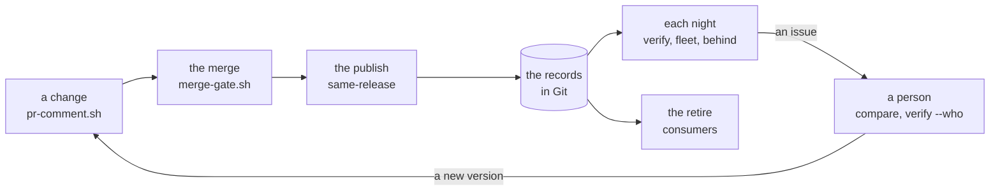

# The everyday loop

Strata is one loop, and each command is one step of it. A team approves the
content of a release, and not only its name. The pipeline publishes it. A record
in the repository keeps the approved content. From then on, each step compares
Palette with that record. Each difference reaches a person as a comment, a
gate that fails, or an issue.

The record is the witness. Palette can change a published version in place, and
Palette keeps no digest of the content. A record in Git, checked against
Palette, stays true when Palette changes.
[Where each part belongs](./boundary.md) gives the reasons.

## Who runs what, and when

| When | Who | The question | What runs | Page |
| --- | --- | --- | --- | --- |
| A change | the author, in a pull request | What does this change do to the clusters? | `pr-comment.sh`: `snapshot --from-candidate` and `compare` | [Review a change](./use-cases/review.md) |
| The merge button | the merge gate | Do the records after the merge still hold? | `merge-gate.sh` | [The merge gate](./automation/merge-gate.md) |
| The publish | the pipeline of the team | Does Palette hold what the reviewer approved? | `snapshot`, then `same-release` | [Review a change](./use-cases/review.md) |
| A promotion | a person, on demand | Do the projects hold one release? | `same-release` | [Promote a release](./use-cases/promote.md) |
| Each night | a scheduled job | Did Palette change under a record? | `verify-report.sh` | [Drift issues](./automation/drift-issues.md) |
| Each night | a scheduled job | Which clusters are the fleet? | `snapshot filter:<name> --dir --prune` | [Find the fleet](./use-cases/fleet.md) |
| Each night | a scheduled job | Does the registry have newer versions of what we pin? | `upstream-report.sh` | [Upstream issues](./automation/upstream-issues.md) |
| An incident | a person at a terminal | Who carries this pack, who runs it, what changed, and who changed it? | `list --pack`, `consumers`, `compare`, `verify --who` | [Find the profiles that carry a pack](./use-cases/find-a-pack.md) |
| The end of a version | a person, on demand | Does anything still use it? | `consumers` | [Retire a version](./use-cases/retire.md) |



Strata publishes nothing, and it deletes nothing. The pipeline of the team does
each write, and it decides what to do with each answer.

## One change, from the pull request to the retire

This section follows one team through one change. The tenant has the projects
`dev` and `prod`. Each runs `aws-stack@1.0.0` on a cluster `payments`, and the
cluster in `prod` has the label `env=prod`. The saved tag filter `production`
selects that label. The repository of the team has `main`, with a record of
each project.

**Follow along.** `just playground loop-1` serves this tenant on this machine,
with no key and no cost. The tenant changes as the day goes on, so this page
has four seeds. Each section names the one it needs.

### 1. The change

A developer writes `aws-stack@1.1.0` as a candidate file on a branch. The job
of the pull request compares it with the record of what `dev` runs, and posts
the comment:

```text
{{#include output/loop-review.txt}}
```

The result line counts the packs that changed, and the rest of the comment names
each one with its impact. The maximum impact is
`repave`, so the job adds the label `repave`, and the rules of the team can ask
for a second approver.

### 2. The merge

The merge gate answers for the records after the merge, not for the branch as
it was when somebody opened it:

```text
{{#include output/loop-merge.txt}}
```

### 3. The publish

**Follow along.** `just playground loop-2` is the tenant after the pipeline
published `aws-stack@1.1.0` in `dev`.

The pipeline publishes the candidate, records the published version, and asks
whether it is the version that the reviewer read:

```text
{{#include output/loop-publish.txt}}
```

`IDENTICAL`: the root of the published version is the root of the candidate. No
tag and no name is trusted. `dev` moves `payments` to the new version, and the
cluster runs it:

```text
{{#include output/loop-cluster.txt}}
```

### 4. The promotion

`prod` gets the version, and the promotion gate asks whether the two projects
hold one release:

```text
{{#include output/loop-promote.txt}}
```

### 5. The night

**Follow along.** `just playground loop-3` is the tenant after the promotion.

The fleet comes from Palette, not from a list that a person keeps. The job
records each cluster that the filter `production` selects, and commits the
directory:

```text
{{#include output/loop-fleet.txt}}
```

**Follow along.** `just playground loop-4` is the tenant after a person edits
`aws-stack@1.1.0` in `prod` in place, through the API, with no review.

The scheduled verify finds the edit, and keeps one issue open for it:

```text
{{#include output/loop-nightly.txt}}
```

`--who` adds who wrote the change, from the audit log of Palette:

```text
{{#include output/loop-who.txt}}
```

The other scheduled job finds the pins that the registry has passed. This is a
decision for a person, not an error, so it is a separate job:

```text
{{#include output/loop-upstream.txt}}
```

### 6. The incident

A pack has a security problem. A person asks which versions carry it, in each
project, and which clusters run them:

```text
{{#include output/loop-incident.txt}}
{{#include output/loop-consumers.txt}}
```

### 7. The retire

Nothing runs `aws-stack@1.0.0` now. The retire gate is open:

```text
{{#include output/loop-retire.txt}}
```

## Behind is not different

Palette tells a cluster that an update of its profile waits. That is a
different question from the one that the record answers:

| Palette says | The record says | What happened |
| --- | --- | --- |
| an update waits | the release drifted, the cluster did not | somebody changed the published version; the cluster keeps its copy until a person accepts the update |
| no update waits | the cluster drifted | somebody changed the cluster, such as a value overridden on it; nothing in Palette waits for it |
| no update waits | nothing drifted | the cluster runs the approved release |

A value that a person overrides on a cluster opens no notification. Only the
record of the cluster shows it. See
[A cluster does not run its release](./use-cases/cluster-release.md) and
[A published version is edited in place](./use-cases/edited-in-place.md#read-the-two-verdicts-as-a-pair).

## Palette behavior

The live run of `just live-loop` runs this loop end to end against a tenant,
with the records in a git repository: the comment, the merge gate, the publish,
the nightly jobs, a value overridden on a cluster, an edit in place, an
incident, and a retire. See
[What the live example verifies](./development/live-runs.md#loopsh).
