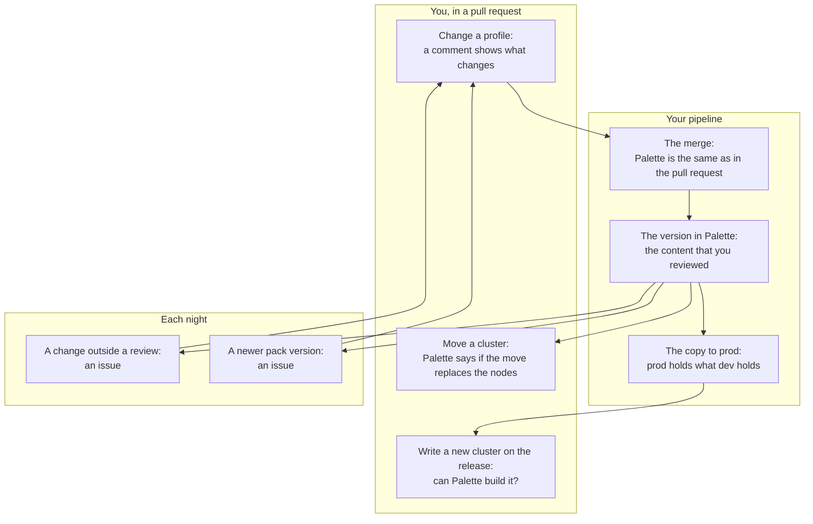

# One change, start to end

This page follows one team through one change, with the output of each command.
Read [The everyday loop](./loop.md) first: it says when to use strata, how to
start, and what a normal day holds.

## Each step at a glance

Each row is one thing that you do, and what strata tells you then.
[The jobs and their commands](#the-jobs-and-their-commands) gives the command and
the page of each job.

| You do this | Strata tells you | Where it runs |
| --- | --- | --- |
| You open a pull request that changes a profile | What changes in each pack, and its impact level, such as a repave. Palette says if it accepts the packs. | the job of the pull request |
| You merge | When Palette changed after the review, or the merge moves a pin back, the gate fails, and the merge stops. | the merge gate |
| The pipeline publishes the version | When Palette holds other content than the content that you reviewed, the job fails. | the job after the merge |
| You move a cluster to the version | Palette says if the move replaces the nodes, before the move. | the pull request of the move |
| You copy the release to `prod` | When `prod` holds other content than `dev`, the job fails. | the promotion gate, on demand |
| You write a new cluster | When Palette cannot build it, the pull request says why, before the build. | the job of the pull request, and the pipeline before the build |
| Each night, with no person at work | An issue opens when somebody changes a version or a cluster outside a review, or when a pack that you pin has a newer version. | the jobs of the night |
| A pack has a security fault | Each profile and each cluster that carries the pack, what changed, and who changed it. | a person at a terminal |
| You delete an old version | When a cluster or a template still uses it, the gate stays closed. | the retire gate, on demand |
| A job writes a note about a value that strata does not know | The value, the route that gave it, and a link that opens an issue of strata. Strata sends nothing unless you choose the send. | a person at a terminal, on the machine of the job |
| You want the answers all day, between two nights | A page shows when Palette holds other content than the records, and who made the change. It also shows whether the cluster took it, and which pins have newer versions. | the observer, in the cluster |

The chart shows the steps of one change. An arrow goes from a step to the step
that it leads to. An issue of the night leads to a pull request.



Strata publishes nothing, and it deletes nothing. The pipeline of the team does
each write, and it decides what to do with each answer. Strata sends nothing about
your tenants either, unless a person chooses the send, with `STRATA_REPORT=1` or a yes to its one
question. See [What strata can report](./reference/report.md).

## The jobs and their commands

This table is for the person who writes the pipeline. Each row gives the command
of a job and the page that describes it.

| When | Who | The question | What runs | Page |
| --- | --- | --- | --- | --- |
| A change | the author, in a pull request | Does Palette accept the packs? What does this change do to the clusters? | `snapshot --from-candidate --validate`, then `pr-comment.sh`: `snapshot --from-candidate` and `compare` | [Review a change](./use-cases/review.md) |
| The merge button | the merge gate | Do the records after the merge still hold? | `merge-gate.sh` | [The merge gate](./automation/merge-gate.md) |
| The publish | the pipeline of the team | Does Palette hold what the reviewer approved? | `snapshot`, then `same-release` | [Review a change](./use-cases/review.md) |
| The publish | the pipeline of the team | Does the cluster hold the records that the team approved? | `observer-records.sh --revision`, then `kubectl replace` | [The observer](./automation/observer.md#install) |
| The move of a cluster | the pipeline of the team | Does the move repave the nodes? Does Palette accept the packs? | `compare cluster:<name> <version> --repave` and `--validate`, and `pr-comment.sh --repave` on the pull request of the move | [Ask Palette if the change repaves](./commands/compare/repave.md), [Ask Palette if it accepts the packs](./commands/compare/validate.md) |
| A promotion | a person, on demand | Do the projects hold one release? | `same-release` | [Promote a release](./use-cases/promote.md) |
| Before a build | the pipeline, and the person who writes the cluster | Can Palette build this cluster? | `preflight`: the static tier on the pull request, with `pr-comment.sh --preflight` for its comment, the live tier before the build, and the watch during it | [Can Palette build this cluster?](./use-cases/stop-a-build.md) |
| Each night | a scheduled job | Did a version change under its record? | `verify-report.sh`, and `--who` for the writer of a change | [Drift issues](./automation/drift-issues.md) |
| Each night | a scheduled job | Which clusters are the fleet? | `snapshot filter:<name> --dir --prune` | [Find the fleet](./use-cases/fleet.md) |
| Each night | a scheduled job | Does the registry have newer versions of what we pin? | `upstream-report.sh` | [Upstream issues](./automation/upstream-issues.md) |
| An incident | a person at a terminal | Who carries this pack, who runs it, what changed, and who changed it? | `list --pack`, `consumers`, `compare`, `verify --who` | [Find the profiles that carry a pack](./use-cases/find-a-pack.md) |
| The end of a version | a person, on demand | Does anything still use it? | `consumers` | [Retire a version](./use-cases/retire.md) |
| A note of an unknown value | a person, on demand | Which values of Palette does this release not know? | `report`, `report --link`, and `report --sent`; `STRATA_REPORT=1` in the job for the send | [Palette gives a value that strata does not know](./use-cases/unknown-value.md) |

## One change, from the pull request to the retire

This section follows one team through one change. The tenant has the projects
`dev` and `prod`. Each runs `aws-stack@1.0.0` on a cluster `payments`, and the
cluster in `prod` has the label `env=prod`. The saved tag filter `production`
selects that label. The repository of the team has `main`, with a record of
each project.

<div class="playground-demo">

`just playground loop-1` serves this tenant on this machine,
with no key and no cost. The tenant changes as the day goes on, so this page
has five seeds. Each section names the one it needs.

</div>

### 1. The change

A developer writes `aws-stack@1.1.0` as a candidate file on a branch. Palette
does not hold that version yet. The author asks Palette if it accepts the packs
of the candidate. The command changes nothing in Palette, and it writes the
record of the candidate:

```text
{{#include output/loop-candidate.txt}}
```

[Ask Palette before you publish](./commands/candidate.md#ask-palette-before-you-publish)
gives the three routes that check the candidate. The job of the pull request
compares the record with the record of what `dev` runs, and posts the comment:

```text
{{#include output/loop-review.txt}}
```

The result line counts the packs that changed, and the rest of the comment names
each one with its impact. The maximum impact is
`repave`, so the job adds the label `repave`, and the rules of the team can ask
for a second approver.

Palette answers two more questions about a change on a cluster: does it repave
the nodes, and does it accept the packs? It answers for a version that it holds.
The candidate is not in Palette yet, so these questions come in
[step 3](#3-the-publish), after the publish.

### 2. The merge

The merge gate answers for the records after the merge, not for the branch as
it was when somebody opened it:

```text
{{#include output/loop-merge.txt}}
```

### 3. The publish

<div class="playground-demo">

`just playground loop-2` is the tenant after the pipeline
published `aws-stack@1.1.0` in `dev`.

</div>

The pipeline publishes the candidate, records the published version, and asks
whether it is the version that the reviewer read:

```text
{{#include output/loop-publish.txt}}
```

`IDENTICAL`: the root of the published version is the root of the candidate.
The check is by content, not by a tag or a name.

Palette holds the version now, so the pipeline asks it two questions about the
move of `payments`. Does the move repave the nodes? Does Palette accept the
packs?

```text
{{#include output/loop-ask-repave.txt}}
{{#include output/loop-ask-validate.txt}}
```

Each `palette` line is the answer of Palette. Strata compares no value for it.
The two commands exit `1`, because the roots differ. The pipeline reads the
answers, and the team decides. [Ask Palette if the change repaves](./commands/compare/repave.md)
and [Ask Palette if it accepts the packs](./commands/compare/validate.md) give
the codes and the options.

The pull request that moves `payments` can ask the same question. With
`--repave`, `pr-comment.sh` puts the answer of Palette in the comment, and the
label `repave` follows that answer. The table of impacts decides when Palette
gives no answer. The note below says which one decided:

```text
{{#include output/loop-ask-repave-comment.txt}}
```

[Ask Palette if the change repaves](./automation/pr-comments.md#ask-palette-if-the-change-repaves)
gives the rule for the label.

`dev` moves `payments` to the new version, and the cluster runs it:

```text
{{#include output/loop-cluster.txt}}
```

### 4. The promotion

`prod` gets the version, and the promotion gate asks whether the two projects
hold one release:

```text
{{#include output/loop-promote.txt}}
```

### 5. Before a build

<div class="playground-demo">

`just playground loop-3` is the tenant after the promotion.
It also holds the cloud account of `prod`, and it answers the validate routes of Palette.

</div>

`prod` builds a new cluster, `ledger`, on the release that the promotion gave
it. The team writes the body of the create in `cluster.json`, as in
[Can Palette build this cluster?](./use-cases/stop-a-build.md). The output shows
the name, the profile in `prod`, and the pools:

```text
{{#include output/loop-body.txt}}
```

The static tier needs no key. It reads the file and the records, so the pull
request can run it:

```text
{{#include output/loop-preflight-static.txt}}
```

A pipeline runs the same command through `preflight.sh`, which reads its options
from variables. See [On another host](./automation/preflight.md#on-another-host).

The pull request can also show the report. `pr-comment.sh --preflight` posts
`report.md` as a comment of its own, with the marker `<!-- strata-preflight -->`,
and updates it on each push. On GitHub, the reusable workflow
`preflight-comment.yml` does the same in a second job. See
[The report as a comment](./automation/preflight.md#the-report-as-a-comment).

```text
{{#include output/loop-preflight-comment.txt}}
```

Before the build, the live tier asks the validate routes of Palette. They check
the body and create nothing. Here Palette refuses the worker pool: one
`t3.xlarge` has fewer cores than the packs need. `--strict` makes the exit code
`1`:

```text
{{#include output/loop-preflight-live.txt}}
```

The live tier also reads the instance types of the region, and sends the key
pair to the property route. The type, its zone, and the key pair of this body
are correct, so `instance-offering` and `iaas-pod-identity` pass.

A rule over a list, such as `template-outside`, makes one request for each
profile of the body. This body has one profile, so the rule makes one request.
See [A rule over a list](./commands/preflight/tiers.md#a-rule-over-a-list).

The fix is a second worker. Change the file, and ask again.

<div class="playground-demo">

`just playground loop-4` is the tenant where Palette finds no
fault in the new body.

</div>

```text
{{#include output/loop-preflight-fix.txt}}
{{#include output/loop-preflight-clean.txt}}
```

The pipeline builds the cluster on exit `0` only.
[Can Palette build this cluster?](./use-cases/stop-a-build.md) gives the rest:
the watch during the build, the tiers, and how a probe becomes a check.

### 6. The night

<div class="playground-demo">

`just playground loop-4` is the tenant after the promotion
and the fix.

</div>

The fleet comes from Palette, not from a list that a person keeps. The job
records each cluster that the filter `production` selects, and commits the
directory:

```text
{{#include output/loop-fleet.txt}}
```

<div class="playground-demo">

`just playground loop-5` is the tenant after a person edits
`aws-stack@1.1.0` in `prod` in place, through the API, outside the review of
the team.

</div>

The scheduled verify finds the edit, and keeps one issue open for it:

```text
{{#include output/loop-nightly.txt}}
```

`--who` adds who wrote the change, from the audit log of Palette:

```text
{{#include output/loop-who.txt}}
```

The scheduled job takes the same option. With `--who`, the issue lists the
writes, so the person who reads it knows whom to ask. The workflow input is
`who`, and the GitLab variable is `STRATA_WHO`. See
[Name who changed the record](./automation/drift-issues.md#name-who-changed-the-record).

```text
{{#include output/loop-nightly-who.txt}}
```

The other scheduled job finds the pins that the registry has passed. This is a
decision for a person, not an error, so it is a separate job. It reads the
records of `dev`, because Palette answers in the project of the connection:

```text
{{#include output/loop-upstream.txt}}
```

The job also asks Palette if it accepts the move of each pin to the newest
version. The last lines show the bump column of each issue. Here Palette accepts
each move. When Palette refuses a move, the column says `palette refuses`, with
the code and the clusters. `--no-impact` skips the question. See
[Palette accepts the move, or refuses it](./commands/behind.md#palette-accepts-the-move-or-refuses-it).

### 7. The incident

A pack has a security problem. A person asks which versions carry it, in each
project, and which clusters run them:

```text
{{#include output/loop-incident.txt}}
{{#include output/loop-consumers.txt}}
```

### 8. The retire

Nothing runs `aws-stack@1.0.0` now. The retire gate is open:

```text
{{#include output/loop-retire.txt}}
```

## Behind is not different

Palette tells a cluster that an update of its profile waits. That is a
different question from the one that the record answers:

| Palette says | The record says | What happened |
| --- | --- | --- |
| an update waits | the release drifted, the cluster did not | somebody changed the published version; the cluster keeps its copy until a person accepts the update |
| no update waits | the cluster drifted | somebody changed the cluster, such as a value overridden on it; nothing in Palette waits for it |
| no update waits | nothing drifted | the cluster runs the approved release |

A value that a person overrides on a cluster opens no notification. Only the
record of the cluster shows it. See
[A cluster does not run its release](./use-cases/cluster-release.md) and
[A published version is edited in place](./use-cases/edited-in-place.md#read-the-two-verdicts-as-a-pair).

## A value that strata does not know

Palette can add a value to a closed set between two runs of the loop, such as a new type of a
profile. Each job of the loop reads the value with no error, and its exit code stays the same. The
job also writes one note on standard error:

```text
{{#include output/unknown-value-note.txt}}
```

<div class="playground-demo">

`just playground unknown-value` serves a tenant with such a value.

</div>

A job that passes `--quiet` hides the note. The note also adds one line to a log on the machine of
the job. [The note for a value that Palette gives](./reference/compatibility.md#the-note-for-a-value-that-palette-gives)
says what the note and the log hold.

A person who sees the note can run `strata report` on that machine. It prints the values of the
log, and a link that opens a new issue of strata with them. Strata sends nothing unless you
choose it: you read the report, and you decide whether to send it by hand, by the setting
`STRATA_REPORT`, or by a yes to its one question. See
[Palette gives a value that strata does not know](./use-cases/unknown-value.md).

## Palette behavior

The live run of `just live-loop` runs this loop end to end against a tenant,
with the records in a git repository. It covers the comment, the merge gate, the
publish, and the questions to Palette about a move. It covers `preflight` on the
body of a cluster, the nightly jobs, and a value overridden on a cluster. It
covers an edit in place, an incident, a retire, and a read of the log of the
unknown values. See
[What the live example verifies](./development/live-runs.md#loopsh).
